<div align="center">

# ⌚ Unified Health

### One app for every smartwatch you own.

Garmin, Huawei, Zepp/Amazfit, COROS and any Bluetooth-standard band — paired, synced and charted in **one** privacy-first Android app,<br>
instead of five vendor apps that each keep your data in their own silo.


<br>

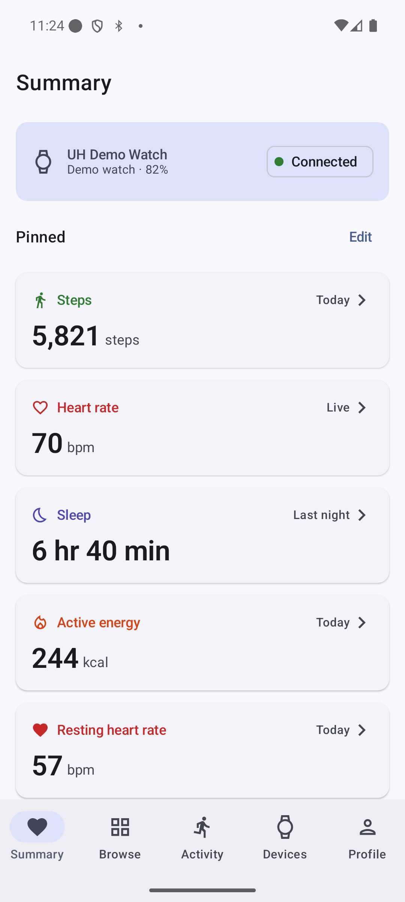
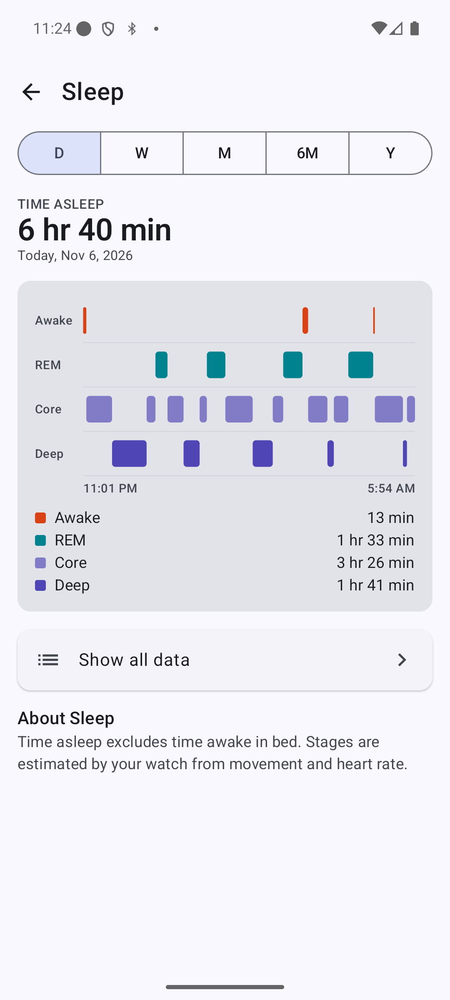
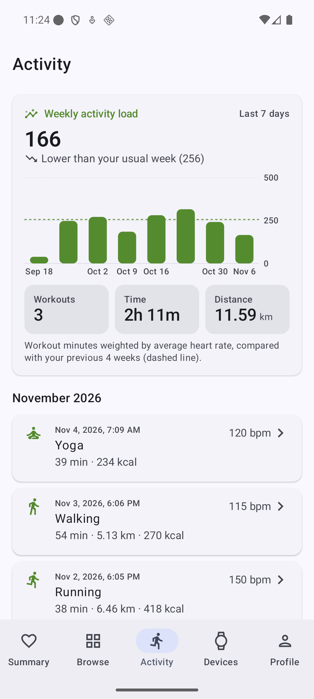
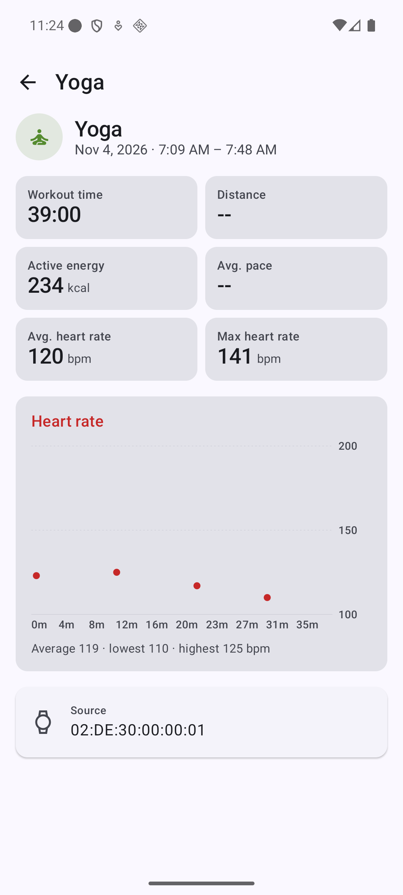

</div>

---

## The problem

Own a Garmin for running and an Amazfit for sleep? That's two apps, two accounts, two clouds — and no single place to see your week. Every brand speaks its own Bluetooth protocol, so the data never meets.

## The solution

**Unified Health talks to each watch in its own language**, directly over Bluetooth Low Energy, and lands everything in one local database with one clean, Apple-Health-style interface. No vendor cloud in the middle. Every reading remembers which watch it came from.

```
  Garmin ─┐  GFDI · COBS · FIT files
  Huawei ─┤  0x5A frames · TLV · AES-CBC
  Zepp ───┼──▶  driver ─▶ session ─▶ sync ─▶ Room ─▶ Summary · Browse · Charts
  COROS ──┤  Protobuf master/slave
  SIG BLE ┘  Heart Rate · Pulse Ox · RSC · Battery
```

---

## ✨ Highlights

- **🔌 Pluggable multi-brand drivers.** Each brand is an isolated `:driver:<brand>` Gradle module behind one `WearableDriver` contract. The scanner scores every advertisement against every driver and the best match wins — adding a brand never touches the UI.
- **📊 Apple-Health-grade UI on Material 3.** Summary with pinned metrics and activity rings, Browse by category, and metric detail with **D / W / M / 6M / Y** ranges, heart-rate range charts, a sleep-stage hypnogram and "Show all data" with source attribution.
- **🏃 Workouts & weekly load.** Workout list and detail (pace, avg/max HR, heart-rate curve) plus an unbranded weekly activity-load trend against your 4-week baseline.
- **🧪 Protocol simulators for every brand.** Debug builds ship virtual Garmin, Huawei, Zepp and SIG watches that speak the *real* wire protocol over an in-memory GATT — so the real driver → session → database pipeline is tested end to end without hardware.
- **📸 Screenshot-driven E2E.** 9 instrumented journeys, 19 flows, **98/98 steps passing**, each step captured and compiled into an ordered visual report.
- **🔒 Privacy by design.** Data stays on the device in Room; mock/demo code is `debugImplementation` only and physically absent from release builds; no vendor secrets are extracted or embedded.

---

## 📱 Screens

| Pair any watch | Summary | Browse | Heart-rate range |
|:---:|:---:|:---:|:---:|
| 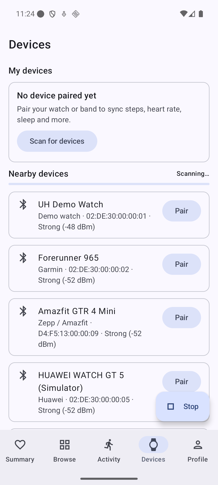 | 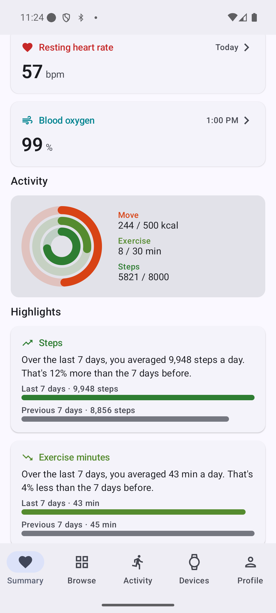 | 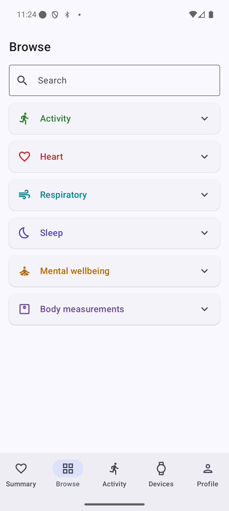 | 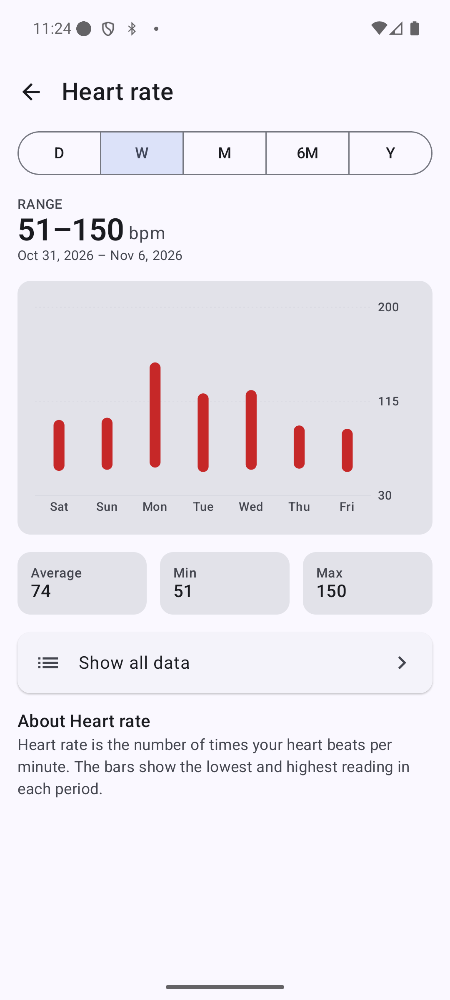 |

| Zepp synced | Garmin synced | About this device | Notifications |
|:---:|:---:|:---:|:---:|
| 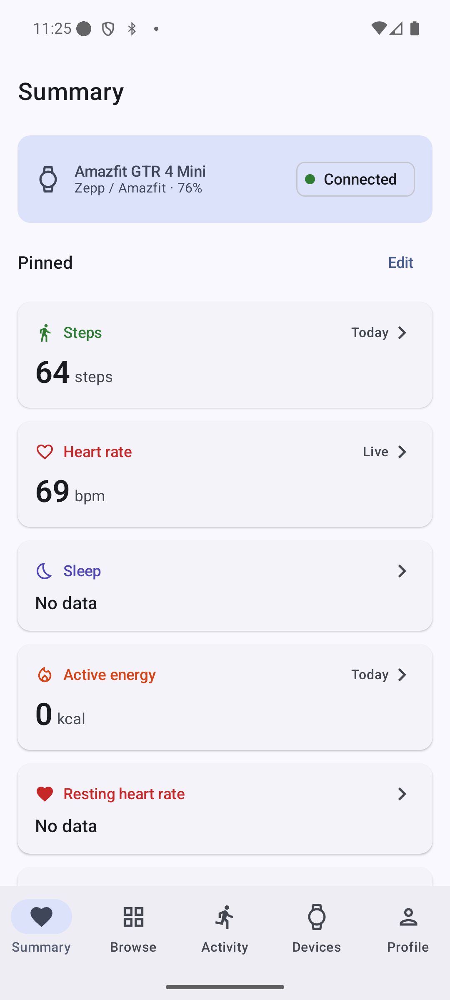 | 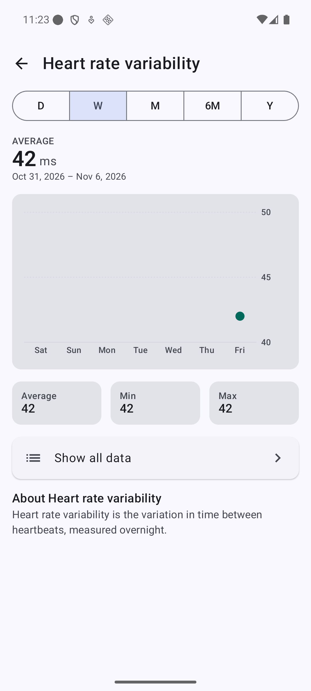 | 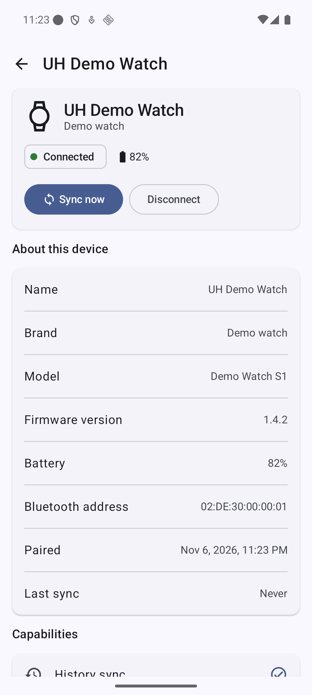 | 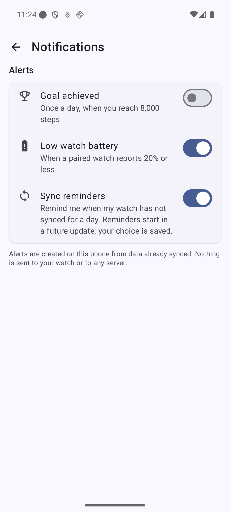 |

👉 **Every step of every flow, in order: [E2E visual report](docs/e2e-report/README.md)**

---

## ⌚ Supported watches

| Brand | How it connects | What syncs | Status |
|---|---|---|---|
| **Bluetooth SIG devices** (Polar/Wahoo straps, pulse oximeters, generic bands) | Standard GATT services | Live HR + HRV, SpO2 (live + stored records), steps from cadence, battery, device info, time write | ✅ Production-ready |
| **Garmin** | GFDI over Multi-Link / dedicated service, COBS + CRC16 | Live HR, time sync, battery, FIT history: steps, HR, resting HR, HRV, stress, SpO2, sleep stages, workouts | ✅ Implemented, simulator-verified |
| **Zepp / Amazfit** | Huami auth (user-supplied key, module 0x80), GDSP | Steps, HR, SpO2 v2, stress, resting HR, time sync | ✅ Implemented, simulator-verified |
| **Huawei** | 0x5A link layer, TLV, AES-CBC | Device version, capabilities, time zone, watch-initiated events | 🟡 Transport done; pairing needs Huawei's own keys → data via Health Connect |
| **COROS** | Protobuf master/slave over a custom UART-style service | Recognition, bonding, battery, device info | 🟡 History sync awaits a real-device Bluetooth capture |

Every byte layout is documented with its evidence and a confidence tag (verified / inferred / public spec) in [`docs/protocols/`](docs/protocols/).

---

## 🏗️ Architecture

```
┌─────────────── UI · feature:* ───────────────┐   Compose (stateless) ◀─ StateFlow ─ @HiltViewModel
├─────────────── Domain · core:domain ─────────┤   pure Kotlin use cases + repository interfaces
├─────────────── Data · core:data ─────────────┤   Room · DataStore · Health Connect
├─────────────── Transport · core:ble ─────────┤   DeviceScanner · DeviceConnection · HealthDataSync
│        DriverRegistry ── recognize() scores ─┤
└──┬────────┬────────┬────────┬────────┬───────┘
   │        │        │        │        │
 standard garmin   huawei    zepp    coros       :driver:* — one Gradle module per brand
```

- **Clean Architecture + MVVM**, single activity, type-safe Navigation Compose.
- **Features never see transport or storage**: `feature:*` depends only on `core:model`, `core:domain`, `core:designsystem`; `:app` wires everything with Hilt.
- **Driver layering**: `Uuids` → pure `codec/` (framing, CRC, TLV, parsers — no Android, fully unit-tested with byte vectors) → `transport/` (chunking, reassembly, ACKs) → `Session` (handshake, sync) → `Driver` (recognition, link requirements).
- **Coroutines everywhere** with explicit timeouts, cancellation-safe session scopes and an injected clock/dispatcher for deterministic tests.
- **18 Gradle modules**, convention plugins in `build-logic/`, versions in `gradle/libs.versions.toml`.

<details>
<summary><b>Module map</b></summary>

```
unified_health_app/
├── app/                  # Single activity, NavHost, Hilt app, DeviceSyncService, health alerts
├── build-logic/          # Convention plugins
├── core/
│   ├── model/            # Domain models (JVM)
│   ├── domain/           # Use cases + repository interfaces (JVM)
│   ├── designsystem/     # M3 theme, charts (bar / range / sleep stages), metric cards
│   ├── ble/              # Multi-vendor scanner/connection/sync, driver contract, VirtualDevice seam
│   ├── data/             # Room, DataStore, LocalHealthDataRepository, MetricSeriesBuilder
│   ├── testing/          # FakeGattClient, RecordingSink
│   └── demo/             # debug-only: mock watch, brand simulators, 90-day seeder
├── driver/
│   ├── standard/  garmin/  huawei/  zepp/  coros/
└── feature/
    ├── onboarding/  home/ (Summary · Browse · Detail)  activity/  devices/  profile/
```
</details>

---

## 🧪 Quality

| | |
|---|---|
| Unit tests | **355** JVM tests — codecs with byte vectors, sessions against scripted fake watches, aggregation and ViewModels |
| Instrumented E2E | **9** journeys · **19** flows · **98/98** steps, screenshot per step → [visual report](docs/e2e-report/README.md) |
| Release hygiene | no mock code in release, lint clean, explicit capability declaration (the UI never promises data a driver can't deliver) |
| Decision log | 90+ recorded engineering decisions with rationale → [`docs/DECISIONS.md`](docs/DECISIONS.md) |

Try it in 30 seconds on an emulator: debug builds include a **UH Demo Watch** and *Profile › Developer › Seed demo data* fills 90 days of realistic, deterministic data.

---

## 🛠️ Tech stack

Kotlin 2.4 · Jetpack Compose (BOM 2026.09, Material 3) · Navigation Compose (type-safe) · Hilt · Room · DataStore · Coroutines/Flow · Health Connect · Android BLE GATT · AGP 9.5 / Gradle 9.8 · minSdk 26, target 37

---

## 🚀 Build & run

Requires Android SDK (platform 37, build-tools 36+) and JDK 17 or 21.

```bash
export JAVA_HOME=/opt/homebrew/opt/openjdk@21          # JDK 27 is not supported by AGP yet
echo "sdk.dir=$HOME/Library/Android/sdk" > local.properties

./gradlew assembleDebug           # app/build/outputs/apk/debug/app-debug.apk
./gradlew testDebugUnitTest       # unit tests
./gradlew installDebug            # install on a connected device/emulator

scripts/e2e.sh [serial]           # build → fresh install → run E2E → build/e2e-report/index.html
```

Debug installs as `com.unified.health.debug`. Disable the demo watch with `-PunifiedHealth.mockDevice=false`. To refresh the published report, copy `build/e2e-report/` to `docs/e2e-report/`.

---

## 🗺️ Roadmap

- Capture real-device Bluetooth logs to finish COROS history sync and Huawei service-7 parsing
- Two-way Health Connect (import Huawei/COROS data today, export everything)
- Concurrent connections to several watches at once
- Swipe through past periods, tap-to-inspect chart values, data-source priority
- Localization (Vietnamese first) and a published privacy policy for Play release

## 📚 More

- Feature spec: [FEATURES.md](FEATURES.md) · Screen inventory of the vendor apps: [docs/SCREEN_INVENTORY.md](docs/SCREEN_INVENTORY.md)
- Protocol docs and evidence: [docs/protocols/](docs/protocols/) · New machine setup: [SETUP_NEW_MACHINE.md](SETUP_NEW_MACHINE.md)

> Built for interoperability with watches you own. Not affiliated with Garmin, Huawei, Zepp Health or COROS; brand names are used only to identify compatible devices.
