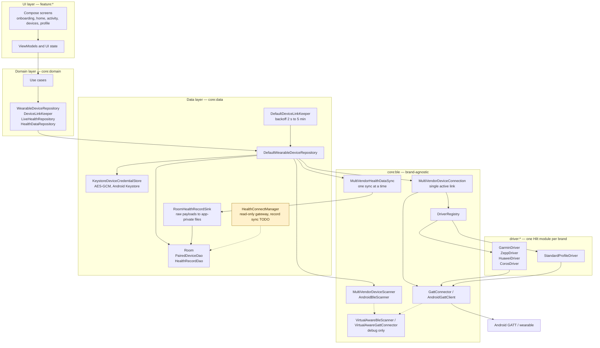
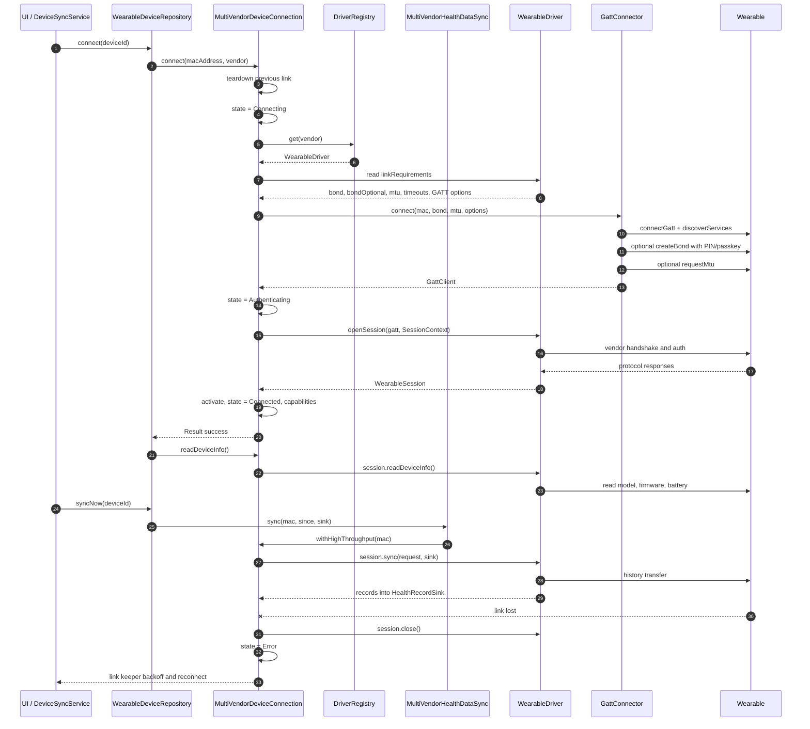

# 01 — Kiến trúc app và vòng đời một kết nối

## 1. Kiến trúc tầng

App là multi-module Gradle. Luồng phụ thuộc một chiều:

```text
feature:*  →  core:domain  →  core:ble  →  driver:*  →  Android GATT
                    ↑              ↓
                core:model     core:data (Room, DataStore, Health Connect)
```

- `feature:*` (onboarding, home, activity, devices, profile) là Compose UI + ViewModel. UI không biết
  vendor nào đang chạy; nó đọc `WearableDevice`, `ConnectionState`, `DeviceCapability`, `SyncState`.
- `core:domain` chỉ chứa interface repository/use case (`WearableDeviceRepository`,
  `DeviceLinkKeeper`, `LiveHealthRepository`, `HealthDataRepository`…).
- `core:data` cài đặt các interface đó: `DefaultWearableDeviceRepository`, `DefaultDeviceLinkKeeper`,
  `DefaultLiveHealthRepository`, `RoomHealthRecordSink`, `KeystoreDeviceCredentialStore`,
  `HealthConnectManager`.
- `core:ble` là lõi BLE **brand-agnostic**: scanner, `DriverRegistry`, `MultiVendorDeviceConnection`,
  `GattConnector`, credential store, contract `WearableDriver`/`WearableSession`. Không có logic Garmin
  hay Zepp trong `core:ble`.
- `driver:<brand>` cài `WearableDriver`, được Hilt gom bằng `@Binds @IntoSet`; thêm brand = thêm module,
  không sửa `core:ble` (D-001).
- `core:demo` chỉ có trong debug/androidTest: simulator đi qua **đúng** pipeline scan → driver →
  session → sync → Room (D-201/D-203).



`HealthConnectManager` chỉ xin quyền đọc và trả `availability`/`grantedPermissions`; phần đọc/ghi record
vẫn là `TODO`. Vì vậy Health Connect **chưa** phải nguồn sync đang chạy; nó là đường dự phòng được thiết
kế cho Huawei watch yêu cầu auth (xem [04-huawei.md](04-huawei.md)).

## 2. Vòng đời một kết nối

### 2.1 Scan → recognize

1. `MultiVendorDeviceScanner.scan()` phát danh sách tích luỹ: `BleScanner.bondedDevices()` trước (watch
   đang kết nối với app hãng thường ngừng quảng cáo), rồi `BleScanner.advertisements()`.
2. `AndroidBleScanner` quét **không** `ScanFilter` (`startScan(null, …)`), vì mỗi brand tự nhận diện
   bằng manufacturer data, service UUID, service data hoặc tên.
3. Mỗi `Advertisement` đi qua `DriverRegistry.identify()`: gọi `recognize()` của mọi driver, lấy điểm
   cao nhất (`RecognitionScore`: NONE 0, NAME 10, STANDARD_SERVICE 20, VENDOR_SERVICE 80,
   VENDOR_MANUFACTURER_DATA 100).
4. Thiết bị không driver nào nhận bị ẩn khỏi danh sách scan.

### 2.2 Pair → GATT connect

`DefaultWearableDeviceRepository.pair()` ghi `PairedDeviceEntity` vào Room. Nếu driver yêu cầu credential
(ví dụ Zepp auth key) mà user chưa nhập, thiết bị được lưu nhưng chưa connect. Ngược lại gọi
`connect(deviceId)`.

`MultiVendorDeviceConnection.connect()` giữ `Mutex` và **teardown link cũ trước**:

1. `state = Connecting`, lưu `activeAddress`.
2. Lấy driver từ `DriverRegistry[vendor]`.
3. Đọc `driver.linkRequirements`: `bond`, `bondOptional`, `mtu`, timeout connect/discovery/operation,
   `refreshGattCacheBeforeDiscovery`.
4. `GattConnector.connect(...)`:
   - `AndroidGattClient.connect()` mở `connectGatt`, chờ connected, chạy `discoverServices` (timeout,
     retry 1 lần cho lỗi transient);
   - nếu `bond=true`, `ensureBonded()` gọi `createBond()` và xử lý PIN/passkey qua
     `PairingCodeRequester`; lỗi bond làm hỏng kết nối **trừ khi** `bondOptional=true` (chỉ Garmin,
     D-417);
   - nếu `mtu != null`, `requestMtu()` best-effort; lỗi MTU chỉ log, không fail phiên.
5. `state = Authenticating`; gọi `driver.openSession(gatt, SessionContext(address, credentialReader,
   credentialWriter))`. Đây là nơi **toàn bộ handshake/auth của brand** diễn ra.
6. Session trả về → `activate()`: gắn watcher `gatt.connected.first { !it }`, đặt connection priority
   `LOW_POWER`, công bố `capabilities`, `state = Connected`.
7. Repository đọc `readDeviceInfo()` và cập nhật model/firmware/battery vào Room.

> Khác biệt đã biết so với vendor: `GattConnector` hiện **discover services trước rồi mới bond**.
> Garmin vendor bond trước discovery; Huawei vendor quyết định bond theo TLV 9 và có thể bond sau
> `0x0101`. Không thấy lỗi trong simulator/unit; cần real-watch để xác nhận với firmware khó tính.

### 2.3 Live và sync

- Live HR: `DeviceConnection.liveHeartRate` là `Flow` của session đang active.
  `DefaultLiveHealthRepository` chỉ collect khi có observer, giữ giá trị cuối, ghi Room theo batch
  (30 s hoặc 60 mẫu) và flush khi dừng.
- History: `DefaultWearableDeviceRepository.syncNow()` → `MultiVendorHealthDataSync.sync()` (Mutex, một
  sync tại một thời điểm) → `session.sync(SyncRequest(since), sink, progress)`. Trước khi sync, connection
  được nâng lên priority `HIGH` rồi hạ lại `LOW_POWER`.
- `RoomHealthRecordSink` map `HealthRecord` sang `HealthSampleEntity`/`WorkoutEntity`; `RawPayload` được
  ghi ra file app-private. Room upsert theo `(device, type, start)` nên giao lại record là idempotent.

### 2.4 Teardown và reconnect

- Người dùng disconnect → `MultiVendorDeviceConnection.disconnect()`: huỷ watcher, `session.close()`,
  `gatt.close()`, state `Disconnected`. `DefaultDeviceLinkKeeper` dừng vì đây là lựa chọn của user.
- Link loss → watcher gọi `onLinkLost()`: bỏ active link, xoá capabilities, `session.close()`,
  `gatt.close()`, state `Error("Connection lost")`.
- `DefaultDeviceLinkKeeper` (chạy trong foreground service `DeviceSyncService`, type `connectedDevice`)
  thấy `Error`, chọn thiết bị đã pair có đủ credential (ưu tiên `lastSyncedAt` gần nhất), rồi reconnect
  với backoff `2 s → 4 s → 8 s …` cap 5 phút. Sau khi connect thành công, nó sync nếu lần sync trước
  cách đây ≥ 5 phút.
- Reconnect **luôn chạy lại handshake/auth từ đầu**. Không có resume ở tầng link: ML handle, nonce,
  ECDH session key… đều bị bỏ. Chỉ dữ liệu được thiết kế là bền (bond, credential, buffer standard) là
  sống qua reconnect.



## 3. Context holding — cái gì được giữ, ở đâu, bao lâu

| State | Nơi giữ | Vòng đời | Ghi chú |
|---|---|---|---|
| Thiết bị đã pair | Room `PairedDeviceEntity` | Bền tới khi unpair | Tên, MAC, vendor, model, firmware, pin, `lastSyncedAt` |
| OS bond | Android Bluetooth stack | Bền tới khi unpair/reset | Garmin/Huawei/COROS yêu cầu; Zepp không |
| Credential | `DeviceCredentialStore` (SharedPreferences mã hoá AES-GCM bằng Android Keystore) | Bền tới khi user xoá/unpair | Key theo MAC; gồm Zepp auth key, Garmin `garmin_auth_info` |
| Active link | `MultiVendorDeviceConnection.active` (`ActiveLink`) | Một phiên | **Chỉ một** active link; `Mutex` serialize connect/disconnect |
| Session object | `WearableSession` do driver tạo | Một phiên | Mất khi disconnect/link loss |
| Capabilities | `DeviceConnection.capabilities` | Một phiên | Lấy từ session; rỗng khi chưa Connected |
| Reconnect policy | `DefaultDeviceLinkKeeper` | Bền trong process + foreground service | Backoff 2 s…5 min; không polling |
| Standard sample buffer | `StandardSampleStore` theo địa chỉ | Bền qua các session trong process | 20 000 record, bỏ cũ nhất; commit sau khi sink ghi thành công |
| Zepp channel state | `ChannelTransport`/`ChannelCipher` | Một phiên | `sessionId`, `r0`/`r1`, module map; auth key thì bền |
| Garmin ML state | `MultiLinkConnector`/`GfdiDispatcher` | Một phiên | Handle, `maxPacketSize`, capability bitmask; LTK lưu bền nhưng fast path chưa dùng |
| Huawei link state | `HuaweiSession.configuration`/`LinkParameters` | Một phiên | Renegotiate mỗi lần connect; không có key bền ở nhánh no-auth |
| COROS generation | `CorosConnectionStateMachine` | Một driver instance | `GattRef` + `ProtocolAttemptToken` chặn callback cũ |

### Vì sao "một kết nối tại một thời điểm"

Thiết kế hiện tại chọn một watch active để đơn giản hoá Android GATT và tiết kiệm pin:
`MultiVendorDeviceConnection` chỉ giữ một `ActiveLink`, `connect()` teardown link cũ, và
`DefaultDeviceLinkKeeper` chỉ chọn một thiết bị đã pair. Vendor app có thể giữ nhiều thiết bị (watch +
strap + sensor) bằng map theo MAC; app này **không** làm vậy. Muốn multi-device phải thay
`MultiVendorDeviceConnection` và policy của keeper, không phải sửa driver.

### Reconnect ra sao với từng brand

| Brand | Reconnect cần gì | State bị mất khi link loss |
|---|---|---|
| Garmin | OS bond còn hiệu lực; nếu không, watch phát 5101 và app-level auth chạy lại | ML handle, `maxPacketSize`, capability bitmask, session cipher |
| Zepp | Auth key đã lưu; firmware còn bound | `sessionId`, nonce, module map, channel cipher |
| Huawei | Bond (nếu watch yêu cầu); `authVersion == 0` thì không cần key | `LinkParameters`, `DeviceConfiguration`, raw watch-initiated queue |
| COROS | OS bond; SIG services | HR buffer trong session (mất); generation token tăng |
| Standard | Không cần gì | Buffer **không** mất (theo địa chỉ); derived window được flush khi close |

## 4. Vì sao thiết kế đặt auth trong driver, không trong core

`WearableDriver.openSession()` là ranh giới duy nhất giữa core và vendor:

- core biết **cách** mở link, bond, MTU, timeout, credential; không biết **nội dung** handshake;
- driver biết byte layout, state machine, crypto; không sở hữu `BluetoothGatt`, không tự scan;
- lỗi auth trả về `WearableProtocolException`/`AuthenticationException`/`UnsupportedDeviceException`;
  `MultiVendorDeviceConnection` chỉ đóng GATT và chuyển state `Error`, UI hiển thị message.

Nhờ vậy cùng một pipeline có thể chạy Standard (không auth), Garmin (bond + GFDI), Zepp (channel auth),
Huawei (no-auth hoặc fail-fast) và COROS (bond + SIG) mà không có `if (vendor == …)` trong core.

## 5. Room, Health Connect và dữ liệu thô

- Room là nguồn dữ liệu chính cho UI: `HealthSampleEntity` (point/interval), `WorkoutEntity`,
  `PairedDeviceEntity`. `MetricSeriesBuilder`/`HealthAggregation` dựng series ngày/tuần/tháng từ đây.
- `RawPayload` (payload chưa decode được) không mất: `RawPayloadSaver` ghi file app-private, đường dẫn
  lưu trong Room. Đây là cách Huawei service 7 và COROS capture giữ được bằng chứng.
- Health Connect hiện chỉ là gateway quyền đọc (`Steps`, `HeartRate`, `Sleep`, `OxygenSaturation`,
  `ExerciseSession`, `ActiveCaloriesBurned`, `Weight`). Chưa có importer; vì vậy không được mô tả
  Huawei/COROS "sync qua Health Connect" là đã chạy.

## 6. Điểm cần kiểm trên đồng hồ thật

Vendor app là chuẩn tham chiếu, nhưng nó chỉ trả lời được **những gì nó làm**. Ở đây chỉ giữ điểm mà
(a) code của ta khác hành vi vendor quan sát được, và (b) static RE không trả lời được.

| Điểm còn mở | Vì sao vendor app không trả lời | Cách xác minh |
|---|---|---|
| **Garmin — bond trước discovery** | Vendor bond trước discovery **chỉ trên pairing connection**; probe/persistent connection discover trước như ta (`pj2/v.java:231,1237-1245`). Firmware có expose GFDI service trước bond trên pairing connection không? | Pair watch chưa bond, xem service/characteristic trước `createBond`; nếu fail, đổi core sang bond-first cho `bond=true`. |
| **Garmin — app auth + clientId** | Flow 5101→5111 đã rõ, nhưng firmware có chấp nhận clientId `0x5548…4801` và auth không phải Garmin Connect không? | Chạy soft-bond fallback trên watch chưa bond; xem 5101/5111 và REGISTER(ML). |
| **Huawei — bond sau TLV 9** | Vendor quyết định bond **sau** `0x0101` theo TLV 9 (0 = không bond, 1/2 = bond khi BOND_NONE); driver đã đổi `bond=false` nhưng `GattClient` chưa có API bond để thực hiện nhánh 1/2 → `TODO(huawei-bond)`. | Trên cùng watch, đọc TLV 9; nếu 1/2 cần thêm bond API vào session rồi xác minh. |
| **Zepp — allowLocalBinding / COROS capture** | Flag do firmware trả lời; COROS command ID bị shell chặn. | Gửi `[0x00]` tới 0x82 và thử local bind; COROS: một HCI snoop log pair+sync ([05-coros.md](05-coros.md)). |

Đã trả lời bằng RE/code — **không** phải điểm kiểm trên watch:
- **Huawei discover-before-bond**: vendor cũng discover trước rồi mới bond sau `0x0101`
  (`HUAWEI_CONNECTION_ANALYSIS.md` §1.2); chỉ Garmin khác.
- **Zepp MTU**: driver đã bỏ `requestMtu` upfront, query module 0x15 (`skip u8 | payload u16 LE`),
  chunk theo `min(payload+3, 247)`, fallback GATT MTU; chỉ còn cần capture để xác nhận giá trị/cadence.
- **`requestMtu` failure**: `GattConnector` đã `runCatching`, lỗi MTU chỉ log; Garmin vendor request 515
  và coi failure là non-fatal (`GARMIN_CONNECTION_ANALYSIS.md` §1); Huawei không request MTU.
- **`refreshGattCacheBeforeDiscovery`**: đúng hành vi vendor Zepp (`GattPeripheral.refreshGatt` trước
  discovery, API ≥28), đã guard API + try/catch + opt-in; không thể fail kết nối.
- **Foreground service/backoff**: hành vi app Android, không phải giao thức watch — xem §2.4 và TODO.
