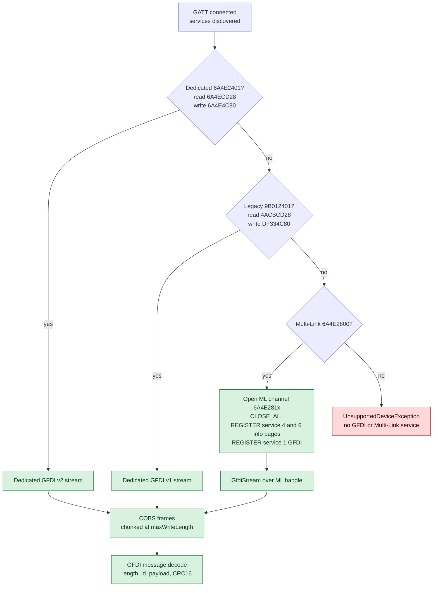
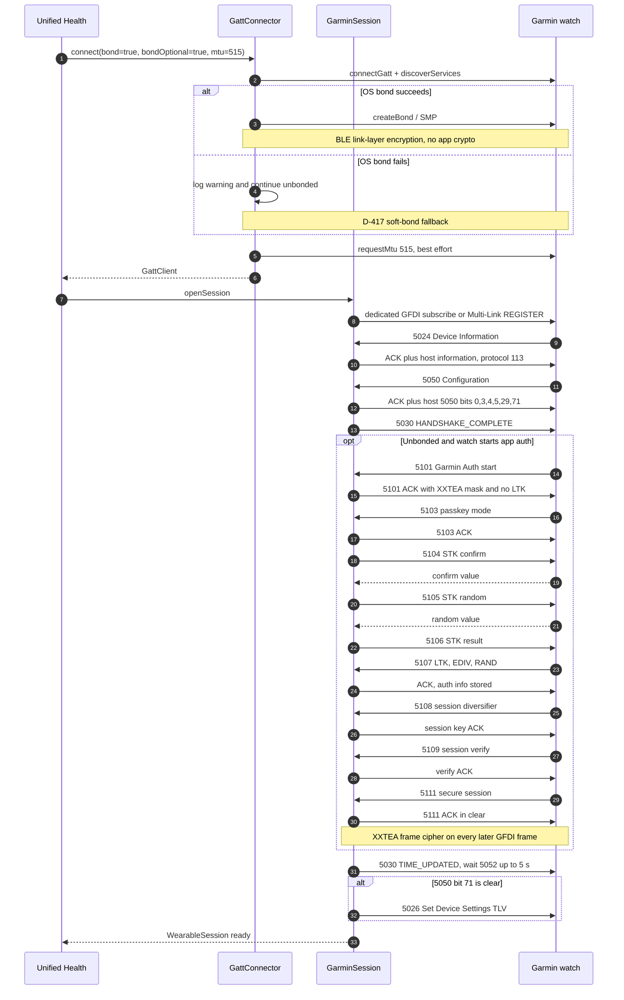
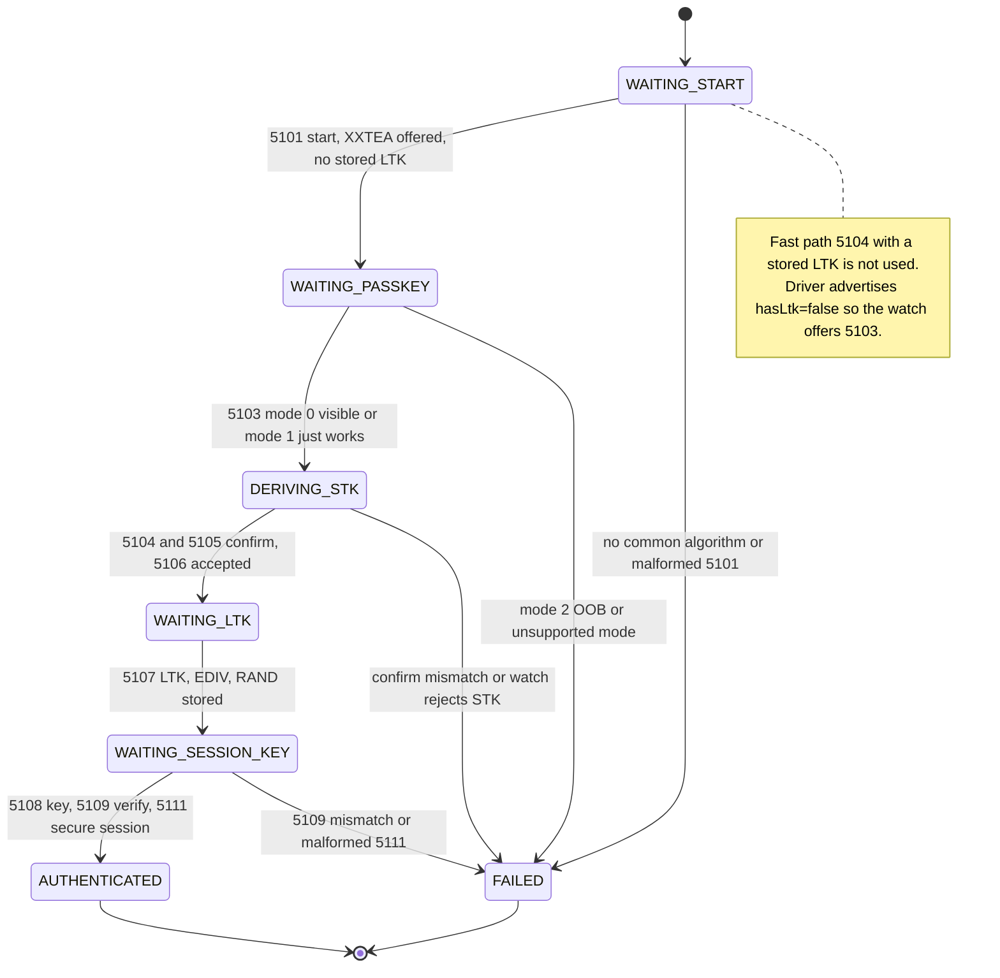

# 02 — Garmin

Nguồn: [GARMIN_CONNECTION_ANALYSIS.md](../analysis/GARMIN_CONNECTION_ANALYSIS.md),
[GARMIN_AUTH_CRYPTO_ANALYSIS.md](../analysis/GARMIN_AUTH_CRYPTO_ANALYSIS.md),
[GARMIN_DEVICE_PROTOCOL.md](../protocols/GARMIN_DEVICE_PROTOCOL.md),
[GARMIN_IMPLEMENTATION_BRIEF.md](../protocols/GARMIN_IMPLEMENTATION_BRIEF.md).
Quyết định: [D-414…D-417](../DECISIONS.md).

## 1. Trạng thái

| Hạng mục | Trạng thái | Bằng chứng |
|---|---|---|
| Discovery + recognition | ✅ implemented | `GarminDriver.recognize()`; unit test |
| GFDI dedicated + Multi-Link | ✅ implemented | `GfdiTransportSelector`, `MultiLinkConnector`; simulator `GarminVirtualDevice` chạy handshake + FIT sync |
| OS bond + soft-bond fallback | ✅ implemented | `LinkRequirements(bond=true, bondOptional=true, mtu=515)`, D-417 |
| Garmin Auth tầng app `5101→5111` | 🟡 unit-tested, chưa simulator/real-watch | `GarminAuthSession`, `GarminAuthCrypto`; simulator Garmin **không** chạy 5101 |
| Real watch | 🟡 chưa xác nhận | Chưa có HCI capture; cloud `registerDevice` không làm |
| Fast LTK path `5104` với LTK đã lưu | **chưa làm** | `GarminAuthSession.onStart` cố ý advertise "no LTK" để ép `5103` |

## 2. Discovery / recognition

Driver chấm điểm theo thứ tự trong `GarminDriver.recognize()`:

1. `manufacturerData` có company ID `0x0087` hoặc byte-swapped `0x8700` → `VENDOR_MANUFACTURER_DATA` (100).
   Vendor đọc thêm 2 byte đầu big-endian làm product number (`dk2/d.java:386-396` [V]); driver **không**
   dùng product number để nhận diện.
2. Có service/service-data thuộc họ Garmin `6A4E????-667B-11E3-949A-0800200C9A66`; hoặc service
   `9B012401-…`; hoặc service data `0x2401`/`0x3E10`/`0xFE1F` → `VENDOR_SERVICE` (80).
3. Tên khớp regex model Garmin (`garmin`, `forerunner`, `fēnix`, `venu`, `vívoactive`, `instinct`,
   `epix`, `enduro`, `edge`, `approach`, `lily`, `quatix`, `marq`, `tactix`, `descent`) → `NAME` (10).

Vendor còn dùng Garmin service data/company ID và scan filter theo MAC khi reconnect; phần scan thuộc
`core:ble`, driver chỉ chấm điểm. `GarminUuids.isGarminFamily()` kiểm tra tiền tố `6a4e` + suffix cố định.

## 3. Transport: dedicated GFDI hay Multi-Link

`GfdiTransportSelector.open()` chọn theo thứ tự cố định, khớp vendor `ma2/a.java:342-397` [V]:



### 3.1 GFDI framing

`GfdiMessage.encode()` tạo:

```text
[len u16 LE = toàn bộ message gồm len + CRC]
[msgId u16 LE]  hoặc  [msgId-5000 u8][txId | 0x80]
[payload]
[crc u16 LE trên mọi byte trước đó]
```

Sau đó `GfdiDispatcher` bọc frame bằng `Cobs.frame()`. Bên nhận `CobsFrameAccumulator` tách frame, bỏ
frame COBS hỏng (watch sẽ retransmit), verify length + CRC16, rồi parse. ACK là message `5000` với payload
`origMsgId u16 | status u8 | data`; status `0..5` (`ACK`, `NAK`, `UNKNOWN_OR_NOT_SUPPORTED`, `COBS_ERROR`,
`CRC_ERROR`, `LENGTH_ERROR`).

Mọi message không phải ACK đều được trả lời ACK hoặc `UNKNOWN_OR_NOT_SUPPORTED`; nếu bỏ im lặng, watch
retry rồi disconnect (§8.B.5).

### 3.2 Multi-Link chi tiết

1. Chọn notify `6A4E2810+i`, write `6A4E2820+i` (fallback notify) với `i` đầu tiên tồn tại; driver
   **không random** channel như vendor.
2. `CLOSE_ALL` cho `clientId` của app, chờ tối đa 5 s (không có trả lời vẫn tiếp tục).
3. `REGISTER service 4` (REGISTRATION) rồi hỏi 6 info page theo thứ tự `0, 1, 3, 4, 2, 5`; mỗi page
   timeout 1 s, retry 5 lần, tổng tối đa 20 s. Nội dung response **không decode** — chỉ cần có trả lời.
   Đây là hành vi mọi lần connect theo D-415.
4. `REGISTER service 1` (GFDI) với flags `0` (plain); chờ tối đa 30 s, bao gồm `PENDING_AUTH (2)`.
   `SUCCESS (0)` → nhận handle; `ALREADY_IN_USE (3)` → lỗi "Garmin Connect đang giữ"; `REJECTED (4)` →
   lỗi client ID/firmware.
5. Nếu response bật `RELIABLE_FLAG`, driver ném `UnsupportedDeviceException` — MLR (`libreliable-ml.so`)
   chưa triển khai.

`MultiLinkRouter` demux packet `[handle u8][payload]`; control dùng handle 0, data theo handle đã register.
Traffic của client khác (Garmin Connect dùng chung characteristic) bị bỏ.

### 3.3 MTU 515 và packet budget

`GarminDriver.linkRequirements` yêu cầu `requestMtu(515)`. ATT write bị giới hạn bởi
`GattClient.maxWriteLength = mtu - 3`; `DedicatedGfdiStream` cắt frame thành chunk theo giới hạn này.
Nhưng `maxPacketSize` trong message `5024` là **link budget**, không phải payload size. `GfdiDispatcher`
dùng `GfdiPacketBudget.usablePayload()`:

```text
cobsOverhead = ceil(maxPacketSize / 254)
budget       = maxPacketSize - cobsOverhead - 8          // plain
budget       = maxPacketSize - cobsOverhead - 18         // encrypted, rồi làm tròn xuống bội số 4
```

Nếu payload vượt budget, driver ném lỗi trước khi ghi, tránh `LENGTH_ERROR`. MTU request thất bại chỉ
log và giữ MTU hiện tại (vendor coi MTU failure là non-fatal).

## 4. Pairing và auth

### 4.1 Hai lớp bảo mật

1. **OS bond (bình thường)** — `LinkRequirements(bond=true)`. Sau khi bond, BLE link-layer đã mã hoá;
   GFDI chạy plain, **không** có app crypto.
2. **Garmin Auth tầng app (fallback)** — chỉ khi OS bond không có/không dùng được. `bondOptional=true`
   (D-417) khiến link tiếp tục unbonded thay vì đóng; watch tự gửi `5101` để bắt đầu.

Thứ tự thực tế trong code: `connectGatt → discoverServices → ensureBonded → requestMtu → openSession`.
Vendor bond trước discovery; đây là khác biệt đã biết, cần real-watch xác nhận.

### 4.2 GFDI handshake và auth fallback



Chi tiết state machine (đúng enum trong `GarminAuthSession.State`):



- Thuật toán: chỉ **XXTEA** (mask bit 0); AES-128 có trong enum vendor nhưng không được offer.
- Passkey: mode 0 = hiện PIN 6 số, lấy qua `PairingCodeRequester`; mode 1 = just-works, passkey 16 byte 0;
  mode 2 = OOB, driver từ chối.
- Confirm `F(key, r) = XXTEA(XXTEA(r,key) XOR reverse(mac)||0… XOR r, key)`; STK = `XXTEA(r[0..7] ||
  w5[0..7], passkey)`.
- `5107` cho `ltk(16) | ediv(2) | rand(8)`; driver lưu `ltk+ediv+rand` vào credential
  `garmin_auth_info`. **Không đọc lại** để chạy fast path 5104 — lý do: chuỗi follow-up chưa xác minh đủ.
- `5108`: `sessionKey = XXTEA(watchDiversifier[0..7] || localRandom[8], ltk)`.
- `5111`: mở secure session; ACK của chính `5111` gửi **plain**, các frame sau mới XXTEA-wrap qua
  `GfdiDispatcher.frameCipher`.
- `GarminAuthSession` timeout mỗi request 10 s (`AUTH_REQUEST_TIMEOUT_MS`); hardware passkey window của
  vendor là 30 s.

Ghi chú chiều message: bảng trong `GARMIN_AUTH_CRYPTO_ANALYSIS.md §1` ghi `5107` là phone→watch, nhưng
`GarminAuthSession` hiện xử lý `5107/5108/5109/5111` như **inbound từ watch** và trả ACK/data. Sơ đồ trên
phản ánh code đang chạy; chiều thực tế cần một HCI log của lần pair app-level để xác nhận.

## 5. Context giữ theo phiên / theo thiết bị

| State | Nơi giữ | Vòng đời | Ghi chú |
|---|---|---|---|
| `clientId` | `GarminDriver.MULTI_LINK_CLIENT_ID` = `0x554845414C544801` | Hằng số app | Không dùng `0x01` của Garmin Connect; firmware có thể reject |
| ML handles | `MultiLinkConnector`, `MultiLinkRouter` | Phiên | Mỗi connect CLOSE_ALL + REGISTER lại |
| Device capability bitmask | `GarminSession.deviceCapabilities` | Phiên | Lấy từ `5050` của watch; dùng chọn time-sync mode |
| Host capability bitmask | `GfdiPayloads.HOST_CAPABILITIES` = `{0,3,4,5,29,71}` | Hằng số | Không mirror bitmask của watch |
| `maxPacketSize` | `GfdiDispatcher.maxPacketSize` | Phiên | Từ `5024`; budget cho payload |
| `unitId`, product, firmware, model | `GarminDeviceInformation` | Phiên | `readDeviceInfo()` trả `DeviceInfo` |
| OS bond | Android stack | Bền | Điều kiện bình thường để không chạy app auth |
| LTK/EDIV/RAND | credential `garmin_auth_info` | Bền | Chưa dùng cho fast path |
| FIT directory/file state | `GarminFileSync` | Phiên | Không archive/delete file trên watch |

Reconnect: core teardown session rồi chạy lại `openSession`; không có ML handle hay cipher nào được tái
sử dụng. Nếu bond còn, watch không gửi `5101`; nếu bond mất, fallback auth chạy lại từ `WAITING_START`.

## 6. Basic ops và FIT sync

- **Device info**: `5024` là bắt buộc và là nguồn model/firmware/unitId. Timeout 20 s; nếu app auth đang
  chạy thì chờ thêm tới 60 s để passkey không bị cắt.
- **Time sync** (D-415): nếu bit 71 trong `5050` bật → gửi `5030 TIME_UPDATED`, chờ `5052` tối đa 5 s và
  trả lời bằng `currentTimeReply` (FIT epoch + timezone + DST). Nếu bit 71 tắt → gửi `5026` TLV. Cả hai
  best-effort, không fail session.
- **Battery**: SIG `0x180F` là nguồn chính; `5023` là fallback. Layout đã xác minh:
  `status = payload[0] & 0x70`, `percent = payload[2]`; driver poll mỗi 10 phút như vendor.
- **Live HR**: thứ tự nguồn trong `GarminLiveHeartRate.sources()`:
  1. characteristic `6A4E2501` của service `6A4E2500` nếu notify/indicate;
  2. Multi-Link service 6 (`REAL_TIME_HR`) nếu watch không expose service realtime;
  3. SIG `0x2A37`.
  Collector đầu tiên mở stream, collector cuối đóng stream; nguồn bị từ chối được bỏ qua ở lần collect sau.
- **FIT sync** (`GarminFileSync`): đọc directory file index `0`; lọc file có timestamp sau `SyncRequest.since`;
  map loại file qua `GarminFitFileType`; tải từng file bằng `5002` (Download Request) rồi nhận `5004`
  (File Data), ghép bằng `FileDataAssembler`; decode FIT và map qua `FitHealthMapper`
  (activity, sleep, stress, SpO2, resting HR, HRV…). Raw file luôn được giữ làm `RawPayload`.
  Không set archive flag `5008`, không xoá file — Garmin Connect vẫn sync được.
- Sau sync gửi `5030 SYNC_COMPLETE` (best-effort).

## 7. Code map

| Việc | File |
|---|---|
| Recognition + link requirements | `driver/garmin/src/main/kotlin/com/unified/health/driver/garmin/GarminDriver.kt` |
| GATT UUID / company ID | `.../GarminUuids.kt` |
| Transport selection, dedicated stream | `.../transport/GfdiStream.kt` |
| Multi-Link register/info pages/router | `.../transport/MultiLink.kt` |
| Request/ACK, COBS, frame cipher hook | `.../transport/GfdiDispatcher.kt` |
| GFDI encode/decode, ACK, packet budget | `.../codec/GfdiMessage.kt`, `.../codec/GfdiPayloads.kt` |
| Handshake, 5024/5050/5030, time, battery, FIT | `.../GarminSession.kt`, `.../GarminFileSync.kt` |
| App auth state machine | `.../auth/GarminAuthSession.kt` |
| XXTEA + confirm + session cipher | `.../auth/GarminAuthCrypto.kt`, `.../codec/Xxtea.kt` |
| Live HR sources | `.../GarminLiveHeartRate.kt` |

## 8. Điều chưa xác minh / rủi ro

1. Firmware có chấp nhận `MULTI_LINK_CLIENT_ID` tự đặt không; nếu reject, chỉ watch có dedicated GFDI
   mới dùng được.
2. `registerDevice` cloud của Garmin Connect có bắt buộc để watch coi client là "paired" không [I].
3. Fast LTK 5104: chưa implement; cần xác minh chuỗi follow-up trước khi bật.
4. Nhánh Garmin Auth chưa có simulator; unit test phủ state machine nhưng chưa chạy end-to-end.
5. Service-4 info-page response layout chưa decode; driver chỉ chờ trả lời.
6. Các realtime stream khác (`2502` steps, `2503` calories, `2508` stress, `250C` SpO2, `250D` body
   battery) chưa có trong driver.
