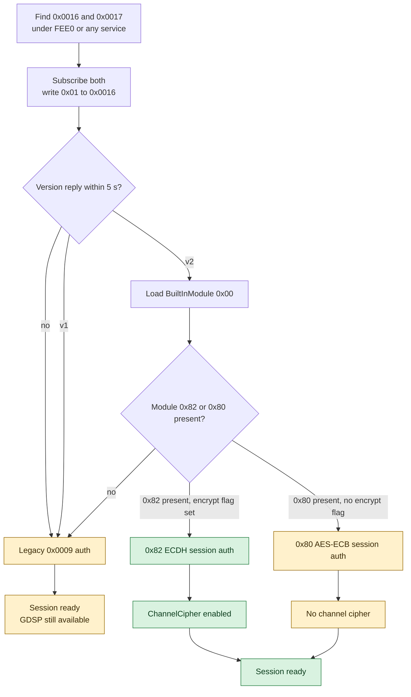
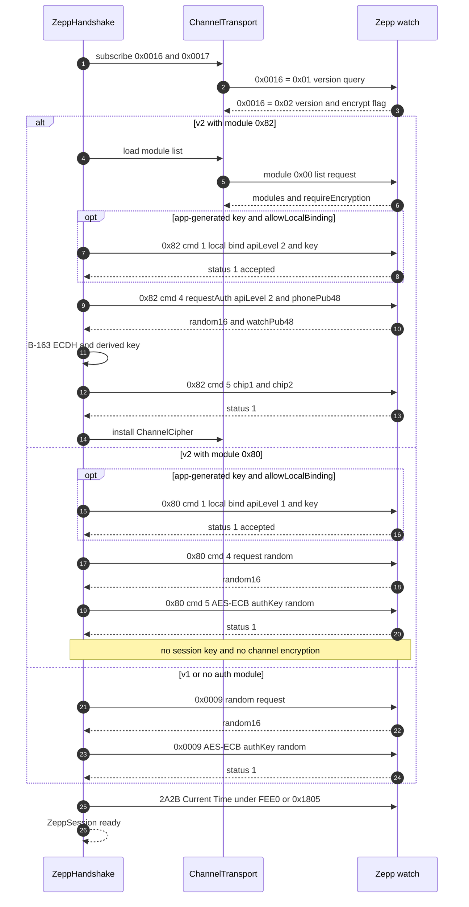
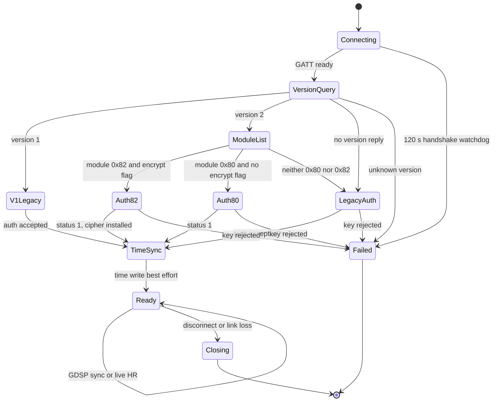

# 03 — Zepp / Amazfit

Nguồn: [ZEPP_CONNECTION_ANALYSIS.md](../analysis/ZEPP_CONNECTION_ANALYSIS.md),
[ZEPP_AUTH_CRYPTO_ANALYSIS.md](../analysis/ZEPP_AUTH_CRYPTO_ANALYSIS.md),
[ZEPP_DEVICE_PROTOCOL.md](../protocols/ZEPP_DEVICE_PROTOCOL.md),
[ZEPP_IMPLEMENTATION_BRIEF.md](../protocols/ZEPP_IMPLEMENTATION_BRIEF.md).
Quyết định: [D-509, D-510, D-511](../DECISIONS.md).

## 1. Trạng thái

| Hạng mục | Trạng thái | Bằng chứng |
|---|---|---|
| Discovery + recognition | ✅ implemented | `ZeppDriver.recognize()`; unit test |
| Channel v1 + legacy `0x0009` | ✅ implemented + simulator | `FakeZeppWatch` unit; `ZeppVirtualWatch` chạy E2E app |
| Channel v2 + module `0x82` ECDH | ✅ implemented + JVM simulator, 🟡 real-watch | `ZeppHandshake`; `FakeZeppWatch` chạy B-163 thật |
| Module `0x80` session auth + local bind | ✅ implemented + JVM simulator, 🟡 real-watch | `AuthModule1Codec`, D-509 |
| Local bind `0x82` | ✅ implemented; 🟡 firmware `allowLocalBinding` chưa xác nhận | D-509/D-510 |
| Cloud first-bind | 🔴 blocked | Cần chữ ký Huami; driver không gọi mạng |
| Real watch | 🟡 chưa xác nhận | Chưa có HCI capture |

App E2E simulator (`ZeppVirtualWatch`) chỉ chạy đường legacy `0x0009` + GDSP; các đường channel v2
được phủ bởi unit/JVM simulator (`FakeZeppWatch`), không phải bởi E2E UI.

## 2. Discovery và GATT

`ZeppDriver.recognize()`:

1. `manufacturerData` có company ID `0x0157` (Huami) → `VENDOR_MANUFACTURER_DATA` (100). ID này là
   `[Ext]`, vendor app không dùng.
2. Advertisement có service `FEE0` (`SERVICE_MILI`) hoặc `FEE1` (`SERVICE_MILI_SECONDARY`) →
   `VENDOR_SERVICE` (80).
3. Tên bắt đầu bằng `Amazfit`, `Zepp`, `Mi Band`, `Xiaomi Smart Band`, `T-Rex`, `GTR`, `GTS`, `Bip`,
   `Balance`, `Active`, `Cheetah`, `Falcon` → `NAME` (10).

Vendor quét `filterUUID(FEE0)`, danh sách tên theo model, hoặc `filterAddress` cho QR; không dùng OS
`ScanFilter` (analysis §1). QR chỉ chứa MAC, không chứa key.

| UUID (Huami base `0000xxxx-0000-3512-2118-0009af100700`) | Vai trò |
|---|---|
| `FEE0` / `FEE1` | Service chính / service phụ chứa legacy auth |
| `0x0016` | Channel down: phone ghi DATA, watch notify ACK + version reply |
| `0x0017` | Channel up: watch notify DATA, phone ghi ACK |
| `0x0004` / `0x0005` | GDSP control / data |
| `0x0009` | Legacy auth control point (FEE1 hoặc FEE0) |
| `0x0006` | Legacy battery characteristic trong FEE0 |
| `0x2A39` | SIG HR control point khi không dùng OpenAppModule |
| `0x2A37` | SIG Heart Rate Measurement, luôn là nguồn sample |
| `2A2B` | Current Time; driver tìm dưới FEE0 trước, rồi `0x1805` |

## 3. Channel v1 / v2

Channel là giao thức chunked: `ChannelTransport.open()` subscribe `0x0016`/`0x0017`, ghi `[0x01]`, chờ
`[0x02, version, encryptEnable?]` trong 5 s.

- **v1**: header không có `appId`; **không** query module list (`BaseProfile.supportModule()` chỉ đúng
  cho v2); luôn dùng legacy `0x0009` (D-510). Driver không tốn 5 s cho module query.
- **v2**: header có `appId` (`HMBleConfig.APP_ID = 0`); `loadModuleList()` gửi module `0x00`
  (`0x03` nếu version reply có byte `encryptEnable`, ngược lại `0x00`), nhận `(id u16, requireEncryption u8)`
  hoặc `id u8`.
- Packet: `type/flags | appId nếu v2 | sessionId | index | totalSize u32 + module u16 ở packet đầu | payload`.
  `NEED_REPLY` mỗi 16 packet và packet cuối; ACK timeout v2 15 s. Driver retry ACK 3 lần (D-511).



## 4. Auth

### 4.1 Auth key đến từ đâu

- **Cloud bind (vendor mặc định)**: `0x82 cmd 2 startCloudBiding` với `phonePub48`; watch trả
  `publicKeyHash16 || watchPub48`; app xin chữ ký `sha256` từ backend Huami rồi gửi `cmd 3 verifySignature`;
  sau đó `authKey = ECDH(phonePriv, watchPub)[0..15]`.
- **Local bind**: user nhập key 16 byte (hex, hoặc chuỗi → MD5); driver gửi key cho watch. Chỉ thành công
  khi firmware báo `allowLocalBinding == 1`.
- **Đã bind**: key lấy từ credential `zepp.auth_key` (user dán từ app Zepp hoặc app tự sinh).

Driver **không bao giờ** gọi mạng Huami. Vì vậy cloud first-bind là 🔴; watch chỉ local-bind được nếu
firmware cho phép, ngược lại phải bind một lần bằng app Zepp rồi dán key.

### 4.2 Session auth `0x82` (theo mỗi kết nối)

1. `B163Ecdh.generateKeyPair()`: private 24 byte, public 48 byte (B-163/sect163r2; `libdevice-encrypt.so`).
2. `cmd 4 requestAuth`: `[0x04, apiLevel u16 LE = 2, 0x02, phonePub48]`.
3. Watch trả `status 1` + `random16 || watchPub48`.
4. `shared = ECDH(phonePriv, watchPub)`.
5. `derived[i] = shared[8+i] XOR authKey[i]` (i = 0..15).
6. `cmd 5 authorize`: `[0x05, AES-ECB(authKey, random), AES-ECB(derived, random)]`.
7. Watch trả status 1 → cài `ChannelCipher(shared, authKey)`.

Ghi chú byte-order: analysis prose ghi "apiLevel u16 BE", nhưng layout đã xác minh trong
`ZEPP_DEVICE_PROTOCOL.md §5.2` và code dùng **u16 LE** (`02 00` cho API level 2). Tài liệu này bám code
+ ví dụ byte; cần real-watch nếu muốn khẳng định tuyệt đối.

### 4.3 Module `0x80` (không ECDH, không channel cipher)

`AuthModule1Codec`, API level 1:

1. `cmd 0 getAuthorizationInfo` → `version u8 | apiLevel u16 LE | allowLocalBinding u8`.
2. `cmd 4 requestRandom`: `[0x04, apiLevel u16 LE = 1, 0x02]` → `random16`.
3. `cmd 5 authorize`: `[0x05, AES-ECB(authKey, random)]`.
4. Không có session key, không mã hoá channel. Local bind dùng cùng dạng `[0x01, apiLevel u16 LE, key16]`
   (D-509 sửa D-501: 0x80 **có** local bind, không chỉ session auth).

### 4.4 Legacy `0x0009`

- Ghi `LegacyAuthCodec.requestRandom()` (`[0x02, appId, ...]`, có fallback short) lên `0x0009`.
- Watch trả `random16`; driver gửi `AES-ECB(authKey, random)`.
- Không channel, không `sessionId`; GDSP vẫn chạy trên FEE0.

### 4.5 Local bind và sequence

`ZeppHandshake.authenticate(authKey, confirmBind)` chỉ bind khi credential có marker
`zepp.auth_key.unbound`; marker **chỉ bị xoá sau khi watch chấp nhận** key. `allowLocalBinding` được đọc
từ `getAuthorizationInfo`; nếu không được phép, driver ném `AuthenticationException` với message
"cần chữ ký server Huami".



`0x82 cmd 1` và `0x80 cmd 1` dùng `apiLevel u16 LE`; watchdog toàn handshake là 120 s trong
`ZeppDriver.openSession` (D-511).

### 4.6 Channel cipher

`ChannelCipher(sharedSecret, authKey)`:

```text
r0 = shared[0..3]  u32 LE   // nonce gửi
r1 = shared[4..7]  u32 LE   // nonce nhận gần nhất
sessionKey = shared[8..23] XOR authKey
packetKey(sessionId) = sessionKey XOR (sessionId & 0xFF) trên từng byte

plaintext  = data || r0 || CRC32(data || r0) || zero-pad tới bội số 16
ciphertext = AES-ECB-NoPadding(packetKey, plaintext)
r0++
```

Nhận: AES-ECB decrypt, verify CRC32, chỉ nhận nonce trong cửa sổ `100000` (chống replay). `ChannelCipher`
sống theo session; auth key thì bền trong credential store.

## 5. Context giữ theo phiên / thiết bị

| State | Nơi giữ | Vòng đời | Ghi chú |
|---|---|---|---|
| Auth key 16 byte | `DeviceCredentialStore["zepp.auth_key"]` | Bền tới unpair | User dán hoặc app sinh; watch reset/unbind làm key đổi |
| Unbound marker | `zepp.auth_key.unbound` | Tới khi bind accepted | `confirmBind` xoá marker |
| `sessionId` | `ChannelTransport.nextSessionId` | Phiên | 0..255, tăng mỗi message |
| `appId` | `ChannelCodec.APP_ID = 0` | Hằng số | Chỉ có trong header v2 |
| Channel version | `ChannelTransport.version` | Phiên | v1/v2 + `encryptEnabled` |
| Module map | `ChannelTransport.modules` | Phiên | `moduleId → requireEncryption`; v1 rỗng |
| Nonce `r0`/`r1`, session key | `ChannelCipher` | Phiên | Không persist; reconnect auth lại |
| GDSP cursor | tham số `SyncRequest.since` + Room `lastSyncedAt` | Bền | Driver không giữ cursor riêng |

Reconnect: `ZeppDriver.openSession` chạy lại version query → auth → time sync → `ZeppSession`; `r0/r1`
và module list bị tạo lại. Auth key và marker (nếu còn) là state bền duy nhất.

## 6. Basic ops

- **Time sync**: `ZeppDriver.syncTime()` tìm `2A2B` dưới `FEE0` trước, rồi `0x1805`; ghi 11 byte
  `[year u16 LE, month, day, hour, min, sec, dayOfWeek, fraction = ms/4, adjustReason, tzKey]`.
  Đây là D-510: vendor dùng FEE0; nhiều watch cũng expose `0x1805`.
- **Battery**: thứ tự nguồn trong `ZeppSession.readBattery()`:
  1. module `0x29` version 1 → `cmd 3` query → `cmd 4` notify, cache giá trị push;
  2. FEE0 characteristic `0x0006` với layout bit-flag;
  3. SIG `0x180F`.
- **Live HR**: nếu channel có module `0x1D` (`OpenAppModule`) → gửi `cmd 4` open/keep/stop, sample vẫn
  đọc từ `0x2A37`; nếu không có module → `0x2A39` control `[0x15,1,1]` + heartbeat `[0x16]` mỗi 10 s.
- **GDSP history** (`0x0004`/`0x0005`): request header → fetch payload → decode → next cursor; các type
  đang sync: ACTIVITY, SPO2_POINT, STRESS_ALL_DAY, STRESS_SINGLE, RESTING_HEART_RATE. Retry transient 3 lần
  từ cursor cuối; lỗi protocol/decode không retry (D-511). `RESTING_HEART_RATE` layout là [I] (D-507),
  cần HCI để xác nhận.

## 7. State machine của một phiên



## 8. Code map

| Việc | File |
|---|---|
| Recognition, link requirements, time sync, watchdog | `driver/zepp/src/main/kotlin/com/unified/health/driver/zepp/ZeppDriver.kt` |
| Chọn auth path, local bind, `0x82`/`0x80`/`0x0009` flow | `.../ZeppHandshake.kt` |
| Channel chunking, module list, ACK | `.../transport/ChannelTransport.kt` |
| `0x82`/`0x80`/legacy codecs | `.../codec/AuthCodec.kt`, `.../codec/ModuleCodecs.kt` |
| B-163 ECDH | `.../codec/B163Ecdh.kt` |
| AES-ECB channel cipher + nonce/CRC | `.../codec/ChannelCipher.kt`, `.../codec/AesEcb.kt` |
| GDSP client + parsers | `.../transport/GdspClient.kt`, `.../codec/GdspCodec.kt`, `.../codec/GdspRecordParsers.kt` |
| Session: battery, live HR, sync | `.../ZeppSession.kt`, `.../ZeppLiveHeartRate.kt`, `.../ZeppOsLiveHeartRate.kt` |

## 9. Điều chưa xác minh / rủi ro

1. `allowLocalBinding` trên firmware Zepp OS hiện tại; driver chỉ JVM-test với `FakeZeppWatch`.
2. Byte order ECDH/nonce trong `libdevice-encrypt.so`; driver hard-code B-163, cần real-watch.
3. Cloud first-bind cần chữ ký Huami → không thể làm trong app local-only.
4. Channel v2 ACK retry semantics từng bị jadx che; driver chọn retry 3 lần theo D-511, cần capture.
5. `RESTING_HEART_RATE` (GDSP 58) layout là [I] (D-507); các type sleep/PAI/sport chưa parse.
6. Sleep không đọc từ module `0x32` (write-only); muốn có sleep cần heuristic `libdataProcess` hoặc
   GDSP type khác, hiện chưa làm.
