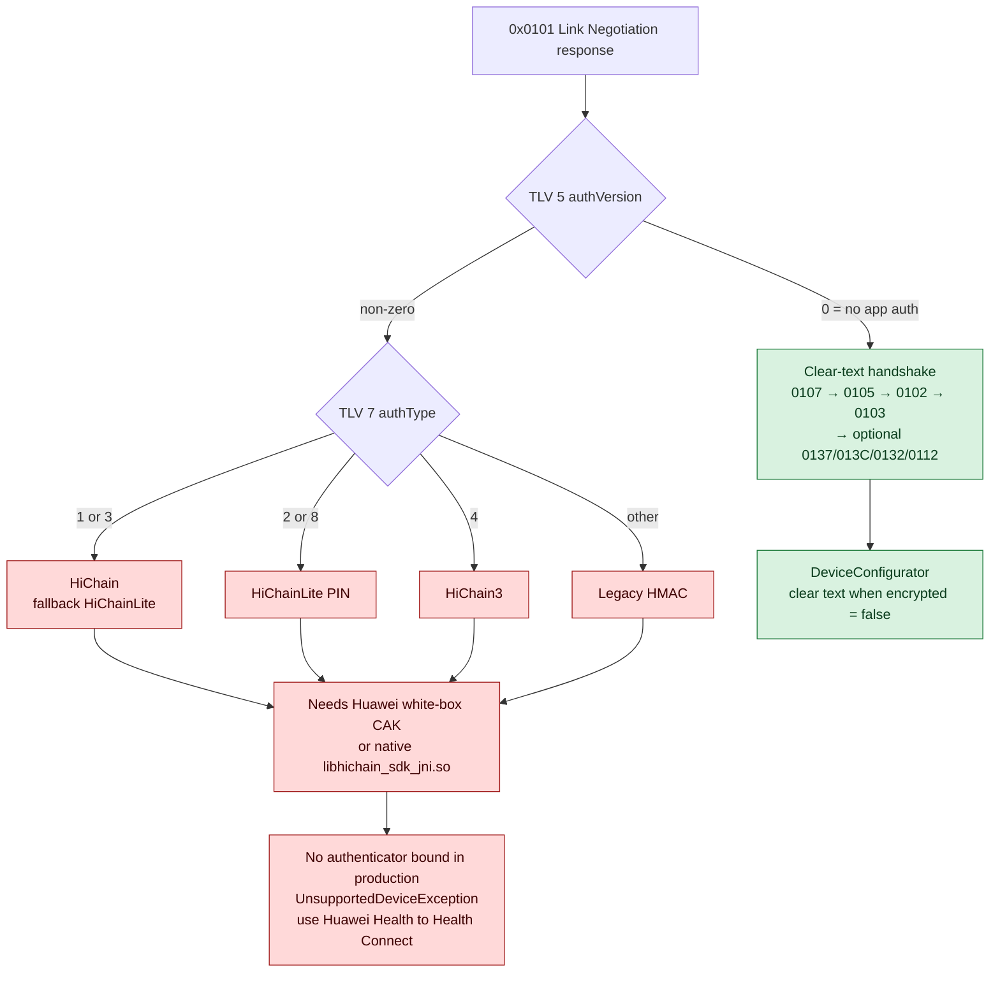
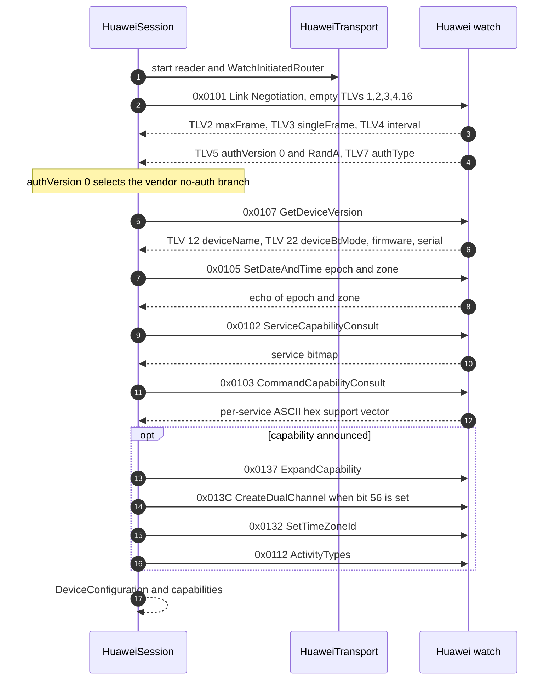
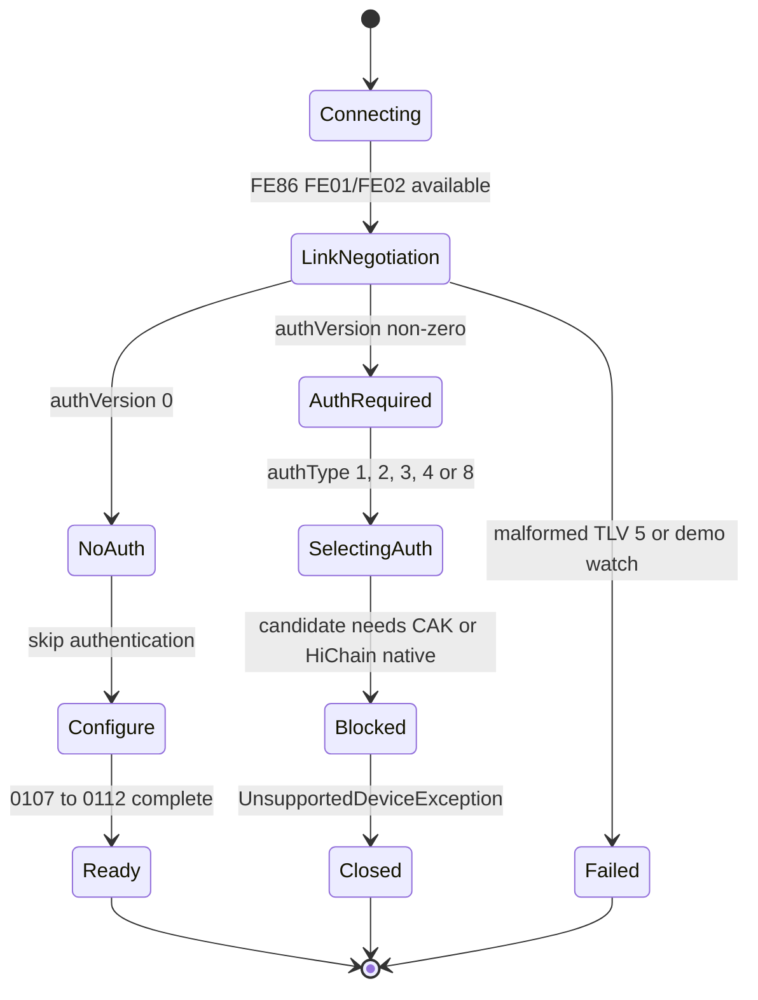

# 04 — Huawei / Honor

Nguồn: [HUAWEI_CONNECTION_ANALYSIS.md](../analysis/HUAWEI_CONNECTION_ANALYSIS.md),
[HUAWEI_AUTH_CRYPTO_ANALYSIS.md](../analysis/HUAWEI_AUTH_CRYPTO_ANALYSIS.md),
[HUAWEI_DEVICE_PROTOCOL.md](../protocols/HUAWEI_DEVICE_PROTOCOL.md),
[HUAWEI_IMPLEMENTATION_BRIEF.md](../protocols/HUAWEI_IMPLEMENTATION_BRIEF.md).
Quyết định: [D-319…D-325](../DECISIONS.md).

## 1. Trạng thái

| Hạng mục | Trạng thái | Bằng chứng |
|---|---|---|
| Discovery + `FE86` | ✅ implemented | `HuaweiDriver.recognize()`; unit test |
| `0x5A` framing, slicing, CRC16-XMODEM, TLV | ✅ implemented | `FrameCodec`, `Tlv`, `FrameReassembler`; unit test |
| `0x0101` link negotiation + `authVersion`/`authType` | ✅ implemented | `LinkParameters`; unit test |
| Nhánh `authVersion == 0` (no-auth) | ✅ simulator-verified | `HuaweiVirtualWatch` chạy E2E app |
| Handshake `0107→0105→0102→0103→0137→013C→0132→0112` | ✅ implemented | `DeviceConfigurator`; simulator/unit |
| Battery svc1 cmd8 + live HR svc23 cmd18 | ✅ implemented, 🟡 real-watch | `BatteryStatus`, `LiveHeartRate`; simulator |
| Service 7 history decode | 🟡 raw-only | `HuaweiSession.sync()` giữ `RawPayload`, không có typed record |
| Auth-required (`authVersion != 0`) | 🔴 blocked | Không có CAK/HiChain; `UnsupportedDeviceException` |
| Real watch no-auth | 🟡 chưa xác nhận | Chưa có capture `0x0101` |

## 2. Discovery

- Service `FE86` (Huawei-assigned) → `VENDOR_SERVICE` (80).
- Tên bắt đầu bằng `HUAWEI WATCH`, `HUAWEI Band`, `HONOR Band`, `HONOR Watch` → `NAME` (10).
- Không có manufacturer company ID đáng tin cậy; vendor app quét **rỗng filter** và lọc bằng bảng tên
  `lvi.java` [V]. Thiết bị Honor có tên viết thường vẫn khớp vì so sánh không phân biệt hoa thường.

`HuaweiDriver.linkRequirements = LinkRequirements(bond = true, mtu = null)`: app vendor tạo OS bond khi
pairing, và **không** gọi `requestMtu` trên watch path — frame size được negotiate trong `0x0101`.

## 3. `0x5A` framing

`FrameCodec` (HUAWEI_DEVICE_PROTOCOL.md §4.1-4.2 [V] `coa.java:56-178`):

```text
single : 5A | len u16 BE = payload+1 | 00            | payload       | CRC16-XMODEM u16 BE
sliced : 5A | len u16 BE = slice+2   | 01/02/03 | idx | slice payload | CRC16-XMODEM u16 BE
```

- CRC phủ mọi byte trước CRC.
- Payload gửi một frame nếu `payload + 6 <= maxFrame`; nếu lớn hơn, cắt slice tối đa `maxFrame - 7`,
  flag 1 = first, 2 = middle, 3 = last, index 1 byte chạy.
- Sau `0x0101`, `FrameSettings` dùng `maxFrameSize`, `singleFrameSize`, `intervalMs` đã negotiate;
  `HuaweiTransport` cắt frame theo `singleFrameSize` trước khi ghi.
- Reassembly (`FrameReassembler`) ghép notification, giới hạn 102 400 byte như vendor; frame sai magic/
  length/CRC bị loại.
- TLV: length base-128 varint; tag ≥ `0x80` là nested (chứa TLV con); `0x7F` là error TLV.

Transport: `FE01` write, `FE02` notify, CCCD `0x2902`. Request/response match theo `(serviceId, commandId)`;
timeout 10 s, 3 lần gửi (vendor `cnx` 10 s/3 sends; `0x010E`/`0x0128` đặc biệt 30 s/3 sends).

## 4. `0x0101` link negotiation và quyết định auth

Request clear text: `01 01 | 01 00 02 00 03 00 04 00 10 00` (TLV 1,2,3,4,16 rỗng; TLV 16 bỏ trên demo
phone). Response (`ckv.java:148-269` [V]):

| TLV | Ý nghĩa | Dùng trong driver |
|---|---|---|
| 1 | bond/ability | không |
| 2 | `maxFrame` | `LinkParameters.maxFrameSize` |
| 3 | `singleFrame` | `LinkParameters.singleFrameSize`; quirk `2698` → `990`/`990`/10 ms |
| 4 | interval | `LinkParameters.intervalMs` |
| 5 | `authenticVersion u16 BE` + `RandA[16]` | `authVersion`, `randA` |
| 7 | `authType` | chọn `HuaweiAuthMode` |
| 9 | bond status; `2` = key-miss | `keyMissing` (chỉ chẩn đoán) |
| 12 | encryption method; `1` = AES-GCM | `cipherMode` |
| 15 | single frame device (display) | log |
| 17 | auth key-info flag (không phải auth selector) | diagnostic |

`authType`/`authVersion` là **do watch khai báo**, không phải app chọn. Driver log cả hai để user biết
vì sao kết nối dừng.



Vì sao blocked: cả 4 nhánh auth đều cần vật liệu vendor.

- Legacy HMAC: CAK xây từ `HealthWhiteBoxManager`/`NdkJniUtils` — native chỉ chạy trong APK Huawei-signed.
- HiChainLite: `Kn` trộn cùng CAK với `PIN`; PIN một mình không đủ. Reconnect bằng device secret thì không
  cần CAK, nhưng lần bind đầu vẫn cần.
- HiChain/HiChain3: OpenHarmony `deviceauth` PAKE qua `libhichain_sdk_jni.so`, không có trong repo và
  không được redistribute.
- Không extract, không nhúng, không bypass (D-322). Watch cần auth nhận lỗi rõ ràng; dữ liệu lịch sử
  đi Huawei Health → Health Connect (phần importer còn TODO, xem [01](01-app-architecture.md) §5).

## 5. Handshake sau auth

Thứ tự app vendor đã xác minh [V] `ckq/ckz/ckn/cki/ckk/ckl/ckw/cko`, driver chạy đúng thứ tự này:

```text
0x0107 GetDeviceVersion
0x0105 SetDateAndTime
0x0102 ServiceCapabilityConsult
0x0103 CommandCapabilityConsult
(0x0137 DeviceExpandCapability)      chỉ khi 0x0103 báo service 1 cmd 0x37
(0x013C DeviceCreateDualChannel)     chỉ khi 0x0137 bitmap có bit 56
(0x0132 SetDeviceTimeZoneId)         chỉ khi 0x0103 báo service 1 cmd 0x32
(0x0112 DeviceSupportActivityType)   chỉ khi 0x0103 báo service 1 cmd 0x12
```

`0x0116 QueryAvailableCommand` là **BR-only**, driver BLE không gửi [V] `ckv.java:131-141`.

### 5.1 `0x0107` GetDeviceVersion

Request là header `01 07` + một empty TLV cho mỗi type cần hỏi. Driver hỏi
`1, 2, 3, 7, 9, 12, 20, 22`; response là các TLV cùng type:

| Type | Field |
|---|---|
| 1 | firmware chính |
| 2 | hardware version |
| 3 | device type/model (fallback model) |
| 7 | health firmware |
| 9 | serial number |
| 12 | **deviceName** (UTF-8) — không phải battery |
| 20 | product model |
| 22 | **deviceBtMode** (UTF-8) |

`0x0107` **không** chứa pin và **không** có capability bitmap (D-319). Pin lấy từ service 1 cmd 8 hoặc
GATT `0x180F`; capability lấy từ `0x0102`/`0x0103`.

Ghi chú model: `HUAWEI_CONNECTION_ANALYSIS.md §5` gợi ý model lấy từ type 10 [I], trong khi code hiện
map `productModel` từ type 20, fallback type 3 (`DeviceVersion.kt`). Tài liệu này bám code; cần real-watch
hoặc capture `0x0107` để chốt type nào thực sự mang tên model.

### 5.2 `0x0132` SetDeviceTimeZoneId

`01 32` là **service/command header**, không phải TLV (D-320). Payload:

- TLV 1 = epoch giây, 4 byte big-endian;
- TLV 2 = UTC offset 2 byte (`hours<<8 | minutes`, cộng `0x80` cho offset âm);
- TLV 3 = IANA zone id UTF-8.

Driver so sánh epoch echo; lệch ≥ 1 s thì gửi lại đúng một lần. 0x0132 chỉ chạy khi `0x0103` báo support
và sau `0x0137/0x013C`, không chạy sớm như code cũ.

### 5.3 `0x0102` / `0x0103`

- `0x0102`: request TLV 1 = `[count-1, serviceId…]`; response là bitmap ASCII hex, bit 0 của byte i =
  service `i+1`. Driver chỉ consult service 1, 7, 23.
- `0x0103`: request nested TLV `0x81`, mỗi service có child TLV 2 = serviceId, TLV 3 = `[cmdCount, cmdIds…]`.
  Response (D-321): nested TLV, child **TLV 2 = serviceId**, child **TLV 4 = ASCII hex support vector**
  (2 ký tự hex mỗi command, `01` supported / `00` không). Driver map thành `CommandSupport`, dùng để quyết
  định battery/live HR và các bước optional.

Ví dụ: live HR chỉ được khai `LIVE_HEART_RATE` khi `0x0103` báo cặp `23/18`; battery protocol chỉ khai khi
service 1 cmd 8 được báo (D-324).

### 5.4 Sequence no-auth



Nếu bất kỳ bước required nào bị từ chối, session fail; transport timeout/link loss cũng fail. Toàn bộ
chạy **clear text** trên nhánh `authVersion == 0` vì không có work key.

### 5.5 State machine nhánh auth-required



Message lỗi nêu rõ auth type, auth version và gợi ý Health Connect; nếu `bondStatus == 2` (key-miss), message
thêm gợi ý unpair trong Android Bluetooth settings.

## 6. Payload envelope và crypto sau auth

`PayloadCipher` (HUAWEI_DEVICE_PROTOCOL.md §6.4; analysis §5 [V] `cjy.java`):

- Service/command id giữ clear; phần TLV còn lại được mã hoá thành:
  `7C 01 01` (encrypted flag) `| 7D 10 <IV> | 7E <len> <ciphertext>`.
  `0x7C/0x7D/0x7E` = decimal 124/125/126.
- AES-CBC/PKCS5 mặc định; AES-GCM khi HiChain3 hoặc link TLV 12 = 1.
- IV 16 byte; nếu có counter seed (từ 0x010F TLV 9) thì counter tăng và ghi big-endian vào byte 12..15.
- Driver chỉ có envelope này; **không có key** trên watch thật vì không có authenticator.

## 7. Basic ops

- **Battery**: service 1 command 8, request `01 08 | 01 00`; response hai format — protocol 0 lấy raw byte
  14, format mới lấy TLV 1 level 0..100 (và TLV 2/3 cho earbud). `BatteryStatus.parse()` nhận cả hai theo
  shape. Fallback GATT `0x180F`.
- **Live HR**: service 23 command 18 payload `01 01 <op>` (1 = open, 0 = close); notify command 3.
  Layout đã xác minh: leaf TLV **3** = heart rate, leaf TLV **4** = epoch seconds; driver cũng chấp nhận
  TLV 4 một byte làm HR cho shape brief cũ. Chỉ bật khi `0x0103` báo `23/18`.
- **History**: driver gửi các request service 7 (today total cmd 3; frame count cmd 4/10/12) và giữ
  response thô dưới dạng `RawPayload` (`huawei_fitness_*`). Không có `HISTORY_SYNC` capability vì chưa
  decode được record nào. Cần HCI capture để parse count TLV + frame body cmd 5/8/11/13.
- **Watch-initiated**: `WatchInitiatedRouter` phân loại service 1/2/7/23/44, giữ tối đa 256 message và
  giao lại dưới dạng `RawPayload` ở sync sau; không gửi ACK vì layout/ACK chưa có bằng chứng (D-317).

## 8. Context giữ theo phiên / thiết bị

| State | Nơi giữ | Vòng đời | Ghi chú |
|---|---|---|---|
| `LinkParameters` | `HuaweiSession.configuration.linkParameters` | Phiên | Renegotiate mỗi `0x0101`; vendor cache theo MAC nhưng driver không |
| Frame settings | `HuaweiTransport.frameSettings` | Phiên | maxFrame/singleFrame/interval |
| `DeviceConfiguration` | `HuaweiSession.configuration` | Phiên | version, supportedServices, commandSupport |
| Work key / cipher | `PayloadCipher` | Phiên | Chỉ có khi authenticator chạy; no-auth không có |
| Watch-initiated queue | `WatchInitiatedRouter` | Phiên | 256 message, drain ở sync |
| OS bond | Android stack | Bền | Driver luôn `bond=true`; vendor bond theo TLV 9 |

Driver không giữ per-MAC cache; mỗi reconnect negotiate lại từ đầu. Với watch `authVersion == 0`, không có
secret nào để lưu; với watch auth-required, không có phiên nào được mở.

## 9. Code map

| Việc | File |
|---|---|
| Recognition + link requirements | `driver/huawei/src/main/kotlin/com/unified/health/driver/huawei/HuaweiDriver.kt` |
| `0x0101`, auth selection, session open | `.../HuaweiSession.kt` |
| Handshake `0107→0112` | `.../DeviceConfigurator.kt` |
| Transport, retry, slicing | `.../transport/HuaweiTransport.kt` |
| `0x5A` frame + CRC | `.../codec/FrameCodec.kt`, `.../codec/Crc16Xmodem.kt` |
| TLV + reassembly | `.../codec/Tlv.kt`, `.../codec/FrameReassembler.kt` |
| `0x0101` parsing | `.../codec/LinkParameters.kt` |
| `0x0107` parsing | `.../codec/DeviceVersion.kt` |
| `0x0102`/`0x0103` | `.../codec/CapabilityConsult.kt`, `.../codec/DeviceConfigCommands.kt` |
| Battery | `.../codec/BatteryStatus.kt` |
| Live HR | `.../codec/LiveHeartRate.kt` |
| Payload envelope | `.../codec/PayloadCipher.kt` |
| Auth plug-in point (empty in production) | `.../auth/HuaweiAuthenticator.kt` |

## 10. Điều chưa xác minh / rủi ro

1. Model nào thực sự báo `authVersion == 0`: cần một lần đọc `0x0101` trên watch thật. Đây là câu hỏi
   quyết định duy nhất, không cần key extraction.
2. Hành vi bond: driver bond trước `0x0101`, vendor quyết định bond theo TLV 9; TLV 9 = 2 key-miss chưa
   được auto-repair.
3. Service 23 cmd 3 nesting và tần suất notify; service 7 layout; 0x0132 response ngoài TLV 1.
4. Watch-initiated message có cần ACK không; hiện chỉ lưu raw.
5. 60 s whole-handshake watchdog và backoff 133 của vendor chưa có trong driver.
