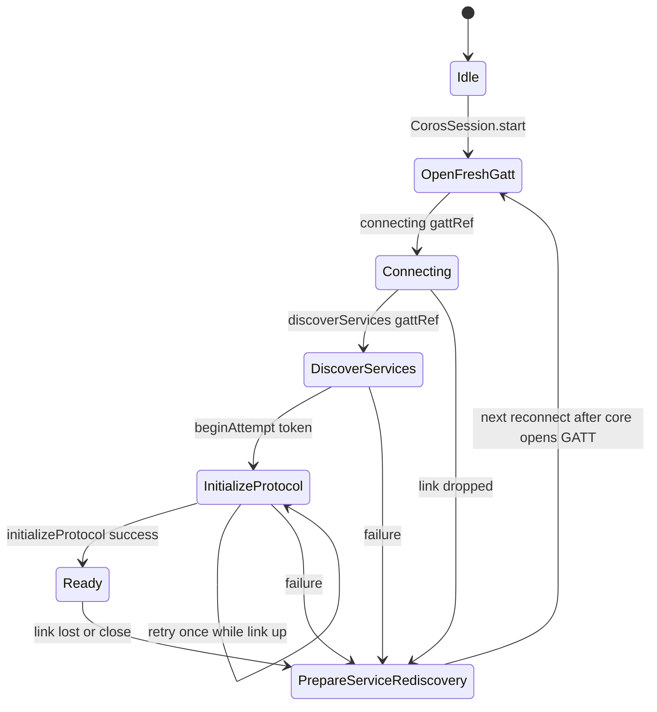
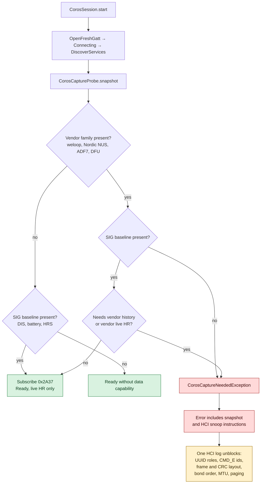

# 05 — COROS

Nguồn: [COROS_CONNECTION_ANALYSIS.md](../analysis/COROS_CONNECTION_ANALYSIS.md),
[COROS_AUTH_CRYPTO_ANALYSIS.md](../analysis/COROS_AUTH_CRYPTO_ANALYSIS.md),
[COROS_DEVICE_PROTOCOL.md](../protocols/COROS_DEVICE_PROTOCOL.md),
[COROS_IMPLEMENTATION_BRIEF.md](../protocols/COROS_IMPLEMENTATION_BRIEF.md).
Quyết định: [D-101…D-109](../DECISIONS.md).

## 1. Trạng thái

| Hạng mục | Trạng thái | Bằng chứng |
|---|---|---|
| Discovery + recognition | ✅ implemented | `CorosDriver.recognize()`; unit test |
| Connection state machine + generation guard | ✅ implemented | `CorosConnectionStateMachine`; unit test |
| OS bond + SIG DIS/battery/HR | ✅ implemented, 🟡 real-watch | `CorosSession`; unit test |
| Live HR qua `0x2A37` | ✅ implemented, 🟡 real-watch | buffer 10 000 trong `CorosSession` |
| History sync (vendor) | 🔴 blocked | Không có command ID/frame layout |
| Vendor live HR / time sync | 🔴 blocked | Cùng lý do |
| Capture diagnostics | ✅ implemented | `CorosCaptureDiagnostics.kt`; unit test |
| Simulator | ❌ không có | Không có `CorosVirtualWatch`; chỉ unit test |

## 2. Recognition

`CorosDriver.recognize()` chấm:

1. Advertisement có một trong `CorosUuids.VENDOR_SERVICES` → `VENDOR_SERVICE` (80):
   - `6E400001-B5A3-F393-E0A9-77656C6F6F70` — weloop/Nordic-UART-style (suffix ASCII "weloop");
   - `6E400001-B5A3-F393-E0A9-E50E24DCCA9E` — Nordic UART chuẩn;
   - `ADF70001-6B99-45E9-98E6-DF67A4C3D291` — họ ADF7;
   - `00001530-1212-EFDE-1523-785FEABCD123` — Nordic DFU.
2. Tên bắt đầu `COROS` → `NAME` (10).

`WELOOP_UART_ALT_SERVICE` (`…-77757C7F7F70`) **không** dùng để nhận diện (D-104); chỉ probe trong
diagnostics. Không có company ID COROS; không có bằng chứng advertisement chứa service UUID thật sự.
`CorosUuids` ghi rõ mọi role RX/TX là `[I]` — chưa xác nhận.

`LinkRequirements(bond = true, mtu = 247)`: bond có bằng chứng gián tiếp (`YfBtSystemBond*`,
`ACTION_BOND_STATE_CHANGED`); MTU 247 là **giá trị chưa xác minh** (D-105).

## 3. Connection state machine

Driver chạy state machine tường minh để mô phỏng tên state còn sống trong APK, không mô phỏng protocol
byte:

- Mỗi lần mở GATT mới, `openFreshGatt()` cấp `GattRef(token)` mới. Nếu còn state active, nó **từ chối**
  mở GATT thứ hai (mô phỏng guard `OpenFreshGatt while another GATT is active`).
- Mỗi protocol attempt có `ProtocolAttemptToken(connectorInstanceId, attempt, gattRef)`. Callback mang
  token/GattRef cũ bị `isCurrent()` từ chối và log `gatt_callback_rejected`; đây là điểm quan trọng để
  notification từ GATT đã đóng không làm hỏng phiên mới.
- Chỉ retry **một lần** cho lỗi không-cancellation khi link còn sống (`MAX_PROTOCOL_ATTEMPTS = 2`).
  Vendor không để lại retry count; đây là bound của app, không phải số của COROS.
- `PrepareServiceRediscovery` là trạng thái teardown chung; vendor có gọi hidden `refresh()` trước close,
  nhưng `GattClient` hiện không expose `refresh()`, nên driver không gọi.

## 4. SIG basics

`CorosSession` là session SIG-only:

- `readDeviceInfo()` = `StandardGattReader.readDeviceInfo()`: DIS `0x180A` (model, firmware, serial) +
  battery `0x180F/0x2A19` nếu có.
- Nếu có `0x180D/0x2A37`: subscribe notify, parse `HeartRateMeasurement`, đẩy vào buffer FIFO 10 000 mẫu
  (~2.5 giờ ở 1 Hz) và phát `liveHeartRate`.
- `capabilities`: `BATTERY_LEVEL` nếu có battery service; `LIVE_HEART_RATE` **và** `HISTORY_SYNC` nếu có
  `0x2A37`.
- `sync()`: nếu `vendorProtocolPresent` → ném `CorosCaptureNeededException`; ngược lại chỉ drain buffer
  HR. Vì vậy cờ `HISTORY_SYNC` **đang overstate**: không có history thật, chỉ có sample live đã buffer.
  Đây là chi tiết cần sửa nếu làm UI capability, nhưng không được tự ý đổi trong tài liệu này.
- Không có time sync, steps, sleep, SpO2, HRV, workout, OTA.

## 5. Vì sao vendor protocol bị chặn

APK `com.yf.smart.coros.dist` 4.11.8 bị bọc bằng shell thương mại; `classes.dex` chỉ còn loader 30 class.
Bằng chứng sống sót là **tên class và string**, không có method body:

- Có `BleCmdPb.MasterSend` / `SlaveAck` / `SlaveNotify`, `BleCmdDefPb$CMD_E`, `CRC16_FIELD_NUMBER`,
  `CRC_FIELD_NUMBER`, `BLOCK_CRC32_FIELD_NUMBER` — nhưng **không có giá trị số** của command ID, không có
  offset header, không có nghĩa các field.
- Có bốn họ UUID nhưng không biết characteristic nào RX/TX, và service nào thực sự nằm trong
  advertisement.
- Bond ordering: `createSystemBond` là call point, nhưng thứ tự bond so với mở GATT/handshake không rõ.
- `bt_cache` Room schema cho thấy sync phân trang (`dataIndex`, `dataGroup`, `stopCode`, `block_crc32`),
  nhưng byte request "xin trang tiếp theo" không đọc được.

Vì driver contract cấm đoán layout, `driver/coros` **không** gửi một byte vendor nào. Đây là lựa chọn có
chủ đích (D-103), không phải thiếu sót implementation.

## 6. Capture diagnostics

`CorosDriver.recognize()` ghi lại advertisement gần nhất cho mỗi địa chỉ vào `CorosCaptureRecorder`
(tối đa 16 địa chỉ, chỉ để chẩn đoán, không ảnh hưởng scoring). Khi `CorosSession.start()` chạy, nó tạo
`CorosCaptureSnapshot` bằng `CorosCaptureProbe`:

| Field | Nguồn |
|---|---|
| `address` | `GattClient.address` |
| `advertisedName` | advertisement lúc scan |
| `bondState` | bond state trong advertisement; `UNKNOWN` nếu chưa thấy |
| `serviceUuids` | các service đã biết trong danh sách probe |
| `characteristicUuids` | các characteristic đã biết thuộc service có mặt |
| `vendorFamilies` | `UART_6E400001`, `ADF70001`, `NORDIC_DFU` |

Giới hạn: `GattClient` chỉ trả lời `hasService(uuid)`/`findCharacteristic(uuid, service)`, **không** liệt
kê được toàn bộ service; snapshot chỉ probe danh sách ứng viên đã biết. Muốn đầy đủ cần HCI log hoặc API
GATT listing.

Snapshot được log một lần mỗi phiên (`CorosCapture`). Khi cần vendor channel mà không có, driver ném
`CorosCaptureNeededException`; message chứa snapshot summary và hướng dẫn capture cụ thể.

## 7. Một HCI snoop log mở khoá được gì

Theo [COROS_CONNECTION_ANALYSIS.md §5](../analysis/COROS_CONNECTION_ANALYSIS.md):

1. UUID family/model nào thật sự dùng; characteristic RX vs TX.
2. Giá trị `BleCmdDefPb$CMD_E` (decode `MasterSend` bằng `protoc --decode_raw`).
3. Outer frame (length/flags, CRC16 vs CRC32, ACK offsets).
4. Thứ tự bond vs handshake, byte `YfBtSystemBondAuth` gửi.
5. Rule chọn protocol V0–V3.
6. MTU thực app yêu cầu (`ATT_EXCHANGE_MTU_REQ`).
7. History paging (`dataIndex`, `dataGroup`, `block_exsit`, request trang kế).
8. Có hay không SIG `0x180D/0x2A37` trên GPS watch.

Cách lấy: Android Developer options → Bluetooth HCI snoop log → pair + sync một lần bằng app COROS →
`adb bugreport` → lấy `btsnoop_hci.log` → Wireshark filter `btatt`. Trước đó có thể dùng nRF Connect để
dump GATT nhanh (gap #1). Không cần unpack shell cho tầng connection.

## 8. Code map

| Việc | File |
|---|---|
| Recognition, link requirements, capture recorder | `driver/coros/src/main/kotlin/com/unified/health/driver/coros/CorosDriver.kt` |
| Session SIG-only, buffer, capture snapshot | `.../CorosSession.kt` |
| State machine + generation tokens | `.../CorosConnectionState.kt` |
| Snapshot/probe + capture exception | `.../CorosCaptureDiagnostics.kt` |
| UUID constants | `.../CorosUuids.kt` |

## 9. Điều chưa xác minh / rủi ro

1. Không có simulator/real-watch; unit test chỉ kiểm recognition, state machine, capture snapshot.
2. `HISTORY_SYNC` capability đang được khai khi có `0x2A37`, nhưng sync chỉ trả live buffer; UI có thể
   hiểu nhầm là có history.
3. MTU 247 và bond-before-handshake chưa xác nhận.
4. Nếu watch chỉ có vendor transport, session fail ngay cả khi user chỉ muốn pin/thông tin cơ bản — vì
   SIG baseline không có. Đây là hành vi đã thiết kế để tránh gửi byte đoán.
