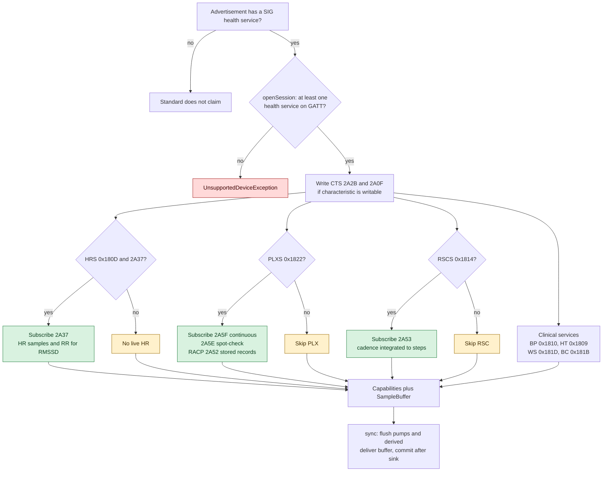
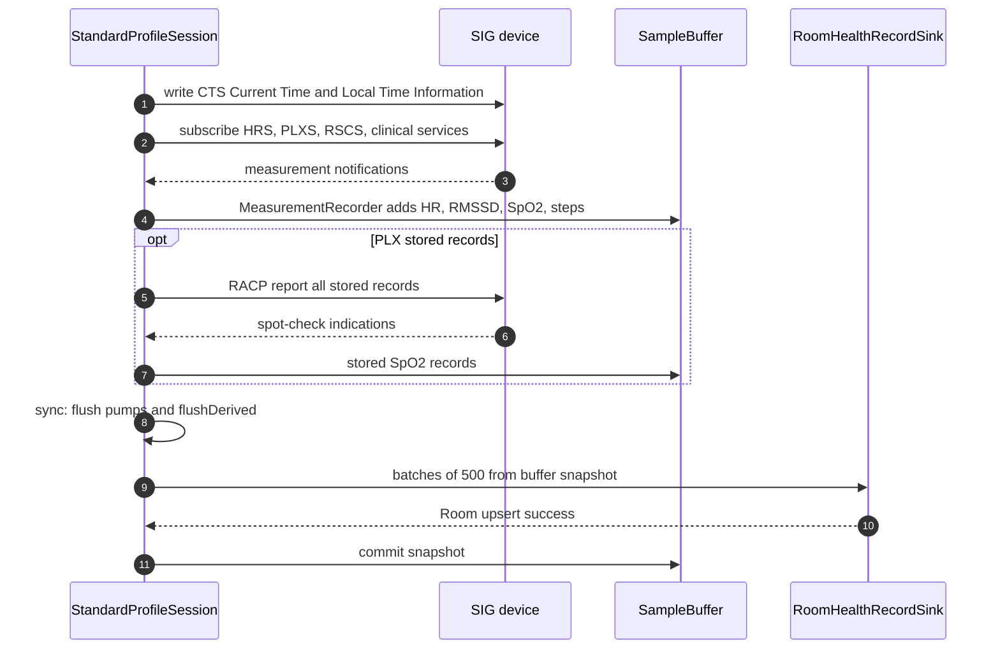

# 06 — Bluetooth SIG standard

Nguồn: [STANDARD_IMPLEMENTATION_BRIEF.md](../protocols/) không tồn tại; driver dựa trên spec công khai
Bluetooth SIG [Ext] và các quyết định [D-601…D-611](../DECISIONS.md). Đối chiếu hành vi với
[01-app-architecture.md](01-app-architecture.md) và code `driver/standard`.

## 1. Trạng thái

| Hạng mục | Trạng thái | Bằng chứng |
|---|---|---|
| Recognition theo SIG health service | ✅ implemented | `StandardProfileDriver.recognize()`; unit test |
| HR live + RR → RMSSD | ✅ implemented | `MeasurementRecorder`, `RmssdWindow`; unit test |
| SpO2 continuous + spot-check | ✅ implemented | `PulseOximeterMeasurement`; unit test |
| PLX stored records qua RACP | ✅ implemented, 🟡 real-watch | `PlxStoredRecordReader`; simulator `StandardVirtualWatch` |
| RSC cadence → steps | ✅ implemented | `CadenceStepCounter`; unit test |
| Clinical BP/temp/weight/body composition | ✅ raw-only | `ClinicalMeasurement` → `RawPayload` |
| CTS time sync | ✅ implemented | `SigTypes.currentTime`, `localTimeInformation` |
| Buffer qua link loss | ✅ implemented | `StandardSampleStore`; D-603 |
| Production | ✅ | Simulator SIG byte-for-byte + E2E `StandardWatchE2ETest` |

Đây là driver duy nhất không có vendor app để RE, nên không có mục "NEEDS-REAL-WATCH" theo nghĩa protocol;
rủi ro còn lại là thiết bị cụ thể không expose đủ service/characteristic như spec.

## 2. Recognition

`StandardProfileDriver.recognize()` trả `STANDARD_SERVICE` (20) nếu advertisement có **một** service trong
`SigUuids.HEALTH_SERVICES`:

- HRS `0x180D`
- PLXS `0x1822`
- RSCS `0x1814`
- Blood Pressure `0x1810`
- Health Thermometer `0x1809`
- Weight Scale `0x181D`
- Body Composition `0x181B`

Chỉ Battery `0x180F`, DIS `0x180A` hoặc CSC `0x1816` **không** đủ để nhận (D-602); CSC có UUID nhưng
chưa decode (D-606), UDS không dùng. Điểm 20 thấp hơn vendor service/manufacturer 80/100, nhưng cao hơn
NAME 10 — nghĩa là một watch vendor chỉ nhận diện bằng tên và có HRS sẽ vào standard (D-602, xem
[README](README.md) flowchart).

`openSession()` kiểm tra lại trên GATT: nếu không có bất kỳ health service nào, ném
`UnsupportedDeviceException`.

## 3. Chọn service và luồng dữ liệu

Thứ tự `start()`: time sync → HRS → PLX continuous → PLX spot-check → RSC → BP → temperature → weight →
body composition. Mỗi pump là best-effort: characteristic thiếu hoặc subscribe lỗi bị log và bỏ qua, các
pump khác vẫn chạy. Nếu **không** pump nào bật được, session fail.

## 4. Live HR, HRV, SpO2, steps

- **HR**: `HeartRateMeasurement.parse()` xử lý cả 8-bit/16-bit value, contact detection và RR intervals.
  Chỉ nhận BPM `25..250`. Sample được đẩy vào `SampleBuffer` và phát `liveHeartRate`.
- **HRV**: `RmssdWindow` tính RMSSD từ RR intervals — cửa sổ 60 s, cần ≥ 20 successive differences, bỏ RR
  ngoài `300..2000 ms` và bỏ cặp lệch > 20 % (ectopic/missed beat). Đây là metric **tính trong app** từ
  dữ liệu SIG, không phải vendor protocol (D-604).
- **SpO2**:
  - PLX continuous (`2A5F`): chỉ lưu tối đa một sample mỗi 10 s để tránh đầy buffer;
  - PLX spot-check (`2A5E`): dùng timestamp của record nếu có; record từ storage không có timestamp bị bỏ;
  - nếu thiếu HRS, pulse rate của PLX được lưu thành `HealthRecord.HeartRate` để không mất live HR
    (`pulseRateAsHeartRate`, D-608).
- **Steps**: `CadenceStepCounter` tích phân `cadencePerMinute` của RSC thành bucket theo phút; gap dài
  (link loss/sensor ngủ) không được integrate. Đây là bước **ước lượng**, không phải step counter phần cứng
  (D-605).
- **Clinical**: BP, temperature, weight, body composition được parse để lấy timestamp/kind nhưng lưu
  `RawPayload`; chưa map thành typed record. Nêu rõ để UI không hứa các metric này.

## 5. Time sync

`StandardProfileSession.syncTime()` ghi `Current Time` (`2A2B`) và `Local Time Information` (`2A0F`) nếu
characteristic tồn tại và writable (`canWriteWithResponse` hoặc `canWriteWithoutResponse`). Ghi lỗi hoặc
timeout 10 s chỉ log, không fail session — nhiều thiết bị chỉ cho đọc clock.

## 6. Buffer và context qua link loss

Đây là điểm khác biệt lớn nhất so với các driver vendor:

- `StandardProfileDriver` là `@Singleton` và giữ `StandardSampleStore` theo **địa chỉ thiết bị**.
- `SampleBuffer` sức chứa 20 000 record (~5.5 giờ HR 1 Hz + derived), bỏ cũ nhất khi đầy.
- `sync()` dùng **hai pha**: `snapshot()` → ghi qua sink → chỉ `commit(snapshot)` sau khi sink thành công.
  Record đến trong lúc sync không bị mất; nếu sink lỗi, lần sync sau giao lại (Room upsert idempotent).
- `close()` gọi `recorder.flushDerived()` để đẩy step bucket/HRV window còn mở vào buffer trước khi session
  chết. Buffer sống tiếp ở driver, nên reconnect không mất sample đã stream (D-603).

Vì vậy Standard là driver duy nhất có "context holding" thật sự ngoài credential: buffer theo MAC tồn tại
qua nhiều session trong cùng process. Nếu process bị kill, buffer mất — đó là giới hạn chấp nhận của D-603.

## 7. Capabilities

| Capability | Điều kiện |
|---|---|
| `HISTORY_SYNC` | Luôn có, vì session luôn có buffer và `sync()` giao được record (dù chỉ là live đã buffer) |
| `LIVE_HEART_RATE` | Có HRS `0x2A37` và subscribe thành công |
| `BATTERY_LEVEL` | Có `0x180F/0x2A19` |

Không có capability cho SpO2/steps/HRV: model `DeviceCapability` hiện chỉ có 3 giá trị; các metric vẫn
được ghi vào Room khi có dữ liệu.

## 8. Code map

| Việc | File |
|---|---|
| Recognition + singleton driver + store | `driver/standard/src/main/kotlin/com/unified/health/driver/standard/StandardProfileDriver.kt` |
| Session start/sync/close | `.../StandardProfileSession.kt` |
| HR/SpO2/RSC → HealthRecord, HRV, steps | `.../MeasurementRecorder.kt`, `.../codec/DerivedMetrics.kt` |
| Buffer 20k + two-phase commit | `.../StandardSampleStore.kt` |
| SIG UUID list | `.../SigUuids.kt` |
| Codec HR/PLX/RSC/clinical/CTS | `.../codec/HeartRateMeasurement.kt`, `.../codec/PulseOximeterMeasurement.kt`, `.../codec/RscMeasurement.kt`, `.../codec/ClinicalMeasurements.kt`, `.../codec/SigTypes.kt` |
| RACP stored records | `.../transport/PlxStoredRecordReader.kt`, `.../codec/RecordAccessControlPoint.kt` |
| Notification pump | `.../transport/NotificationPump.kt` |

## 9. Điều chưa xác minh / rủi ro

1. Thiết bị thật có thể không expose `2A0F`, `2A5F`/`2A5E` hoặc RACP dù advertisement có PLXS; driver bỏ
   qua từng phần, không fail toàn session.
2. `pulseRateAsHeartRate` chỉ bật khi **không** có HRS; nếu thiết bị có cả hai nhưng HRS không notify,
   live HR có thể trống — hành vi đã chọn để tránh duplicate.
3. Steps từ cadence là ước lượng; không thay thế step counter của watch vendor.
4. Chưa map typed BP/temperature/weight/body composition; UI chỉ thấy raw payload.
5. Simulator `StandardVirtualWatch` phủ HR, PLX continuous/spot-check, RACP stored, RSC, CTS, DIS, battery;
   các clinical service chưa có trong simulator.
