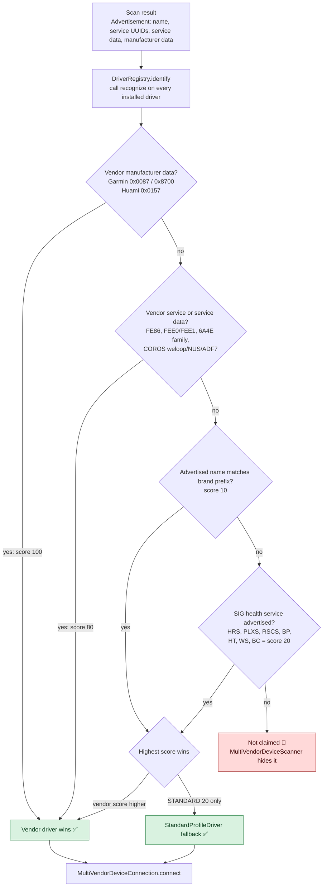

# Kiến trúc Unified Health — kết nối đa thương hiệu

Tài liệu này giải thích **cách app Unified Health đi từ một quảng cáo BLE đến một phiên đã xác thực
và đồng bộ dữ liệu** cho 5 nhóm thiết bị: Garmin, Zepp/Amazfit, Huawei, COROS và Bluetooth SIG
standard. Mục tiêu là để một người mới đọc repo hiểu trong khoảng 10 phút:

- tầng nào chịu trách nhiệm gì;
- mỗi brand đi qua những bước kết nối/xác thực nào;
- auth nằm ở đâu và vì sao một số nhánh bị chặn;
- state nào được giữ theo thiết bị, state nào chỉ tồn tại trong một phiên;
- reconnect hoạt động ra sao khi chỉ có **một kết nối active tại một thời điểm**.

Đây là tài liệu **mô tả code đang có**. Khi code và tài liệu phân tích lệch nhau, tài liệu này ghi rõ
"implemented" so với "vendor/RE-only"; không có protocol byte-layout nào được suy đoán thêm.

## Cách đọc

| Bước | Đọc | Nội dung |
|---|---|---|
| 1 | [01-app-architecture.md](01-app-architecture.md) | Kiến trúc module, vòng đời một kết nối, context holding, reconnect |
| 2 | Ma trận bên dưới | So sánh nhanh 5 brand |
| 3 | [02-garmin.md](02-garmin.md) → [06-standard.md](06-standard.md) | Trình tự kết nối + auth + sync của từng brand |
| 4 | [07-brand-matrix.md](07-brand-matrix.md) | Ma trận sâu: discovery signal, GATT, bond, auth, state, blocker, evidence |
| 5 | `docs/analysis/*` và `docs/protocols/*` | Bằng chứng gốc `[V]` / `[I]` / `[Ext]` và checklist kỹ sư |

## Legend trạng thái

| Ký hiệu | Nghĩa trong tài liệu này |
|---|---|
| ✅ **implemented** | Có code production trong repo; đã có unit test và/hoặc chạy qua pipeline app thật. Với dịch vụ bên thứ ba (Health Connect) ghi rõ mức đã làm. |
| 🟡 **simulator-verified / chưa real-watch** | Code đã có, đã được kiểm bằng unit test hoặc simulator; **chưa xác nhận trên đồng hồ thật**. Trong bảng chi tiết có ghi rõ là unit-only hay simulator. |
| 🔴 **blocked** | Không thể triển khai tiếp nếu không có vật liệu của vendor (CAK/white-box, cloud signature) hoặc capture HCI. Code **không** đoán command ID/frame layout. |

Quy ước bằng chứng (lấy từ `docs/protocols/`): `[V]` = đọc được trong code decompile, `[I]` = suy luận,
`[Ext]` = spec công khai bên ngoài. Trạng thái "implemented" ở đây chỉ nói về **repo này**, không nói
firmware của mọi model cùng hãng sẽ chấp nhận.

## Ma trận so sánh 5 brand

| Brand | Discovery | Transport | Pairing / auth | Session / context | Sync | Trạng thái |
|---|---|---|---|---|---|---|
| **Garmin** | Company ID `0x0087`/`0x8700`; service data họ `6A4E…`; tên model Garmin | Dedicated GFDI (`6A4E2401` / `9B012401`) hoặc Multi-Link `6A4E2800`; GFDI `COBS + CRC16`; MTU 515 | OS bond trước; nếu bond fail thì `bondOptional` cho phép chạy **Garmin Auth tầng app** `5101→5111` bằng XXTEA | `clientId`, ML handles, capability bitmask, `maxPacketSize`, `unitId`; LTK/ediv/rand lưu theo MAC nhưng fast path 5104 chưa dùng | FIT file qua `5002/5004`; live HR `6A4E2501` → ML service 6 → `0x2A37`; time sync 5030/5052 hoặc 5026 | ✅ unit + simulator GFDI cơ bản; 🟡 real-watch; fast LTK 5104 chưa làm |
| **Zepp / Amazfit** | Huami company ID `0x0157`; `FEE0`/`FEE1`; prefix tên Amazfit/Zepp/Mi Band… | Channel `0x0016`/`0x0017`; GDSP `0x0004/0x0005`; version v1/v2 | Auth key do user cung cấp; `0x82` ECDH, `0x80` AES-ECB, legacy `0x0009`; local bind khi firmware cho phép | `sessionId`, `appId=0`, nonce `r0/r1`, module map, `ChannelCipher` theo phiên; auth key lưu theo MAC | GDSP activity/SpO2/stress/resting HR; battery module `0x29` / FEE0 `0x0006`; time sync `2A2B` | ✅ simulator (legacy `0x0009`); 🟡 real-watch cho ECDH/v2; cloud first-bind 🔴 |
| **Huawei / Honor** | Service `FE86` hoặc prefix `HUAWEI WATCH` / `HUAWEI Band` / `HONOR …` | `0x5A` frame: single/sliced, CRC16-XMODEM, TLV varint lồng nhau | `0x0101` → `authVersion` + `authType`; chỉ nhánh `authVersion == 0` là không cần auth | `LinkParameters` theo phiên (frame size, interval, RandA); không có work key ở nhánh no-auth; raw watch-initiated queue | Service 7 request thô, chưa decode record; battery svc1 cmd8; live HR svc23 cmd18 + notify cmd3 | ✅ no-auth (simulator); 🟡 real-watch; auth-required 🔴 |
| **COROS** | Prefix `COROS`; custom UUID weloop/Nordic NUS/`ADF7`/Nordic DFU | Vendor "UART-over-BLE" chưa xác định RX/TX; SIG fallback | OS bond; vendor auth/`YfBtAuth` chưa có byte layout | `GattRef` + `ProtocolAttemptToken` generation; capture snapshot; **không** giữ vendor context | Chỉ SIG: DIS, battery, live HR `0x2A37` (buffer 10k); vendor history 🔴 | ✅ basics (unit); vendor protocol 🔴 |
| **Standard (SIG)** | Advertisement chứa một health service SIG | GATT thuần SIG; không vendor framing | Không bond, không app auth | `StandardSampleStore` theo địa chỉ, 20 000 record, sống qua link loss | HRS live, PLXS continuous/spot-check + RACP stored, RSC steps, BP/HT/WS/BC; CTS time | ✅ production |

Chi tiết từng dòng, gồm evidence path và blocker: [07-brand-matrix.md](07-brand-matrix.md).

## Sơ đồ quyết định nhận diện brand

`MultiVendorDeviceScanner` lấy **bonded devices** trước, rồi từng `Advertisement`. Mỗi
`WearableDriver.recognize()` trả điểm theo `RecognitionScore`; `DriverRegistry.identify()` chọn điểm
cao nhất. Điểm `STANDARD_SERVICE = 20` **cao hơn** `NAME = 10` (D-602), nên một đồng hồ vendor chỉ
khớp theo tên mà có phát Heart Rate sẽ vào driver standard; vendor service/manufacturer data
(80/100) luôn thắng.

Ghi chú: nhánh "vendor name 10" và "SIG 20" cùng khớp sẽ chọn standard; đây là hành vi có chủ đích
của D-602, không phải bug. Khi một driver vendor chỉ nhận diện được bằng tên và thiết bị đó phát HRS,
nó sẽ không được chọn — xem lại D-602 nếu gặp model như vậy.

## Danh mục tài liệu

| File | Nội dung |
|---|---|
| [01-app-architecture.md](01-app-architecture.md) | UI → domain → data → `core:ble` → `driver:*` → GATT; vòng đời kết nối; context holding; reconnect; Room/Health Connect |
| [02-garmin.md](02-garmin.md) | GFDI/Multi-Link, COBS+CRC16, MTU 515, OS bond, Garmin Auth `5101→5111`, FIT sync |
| [03-zepp.md](03-zepp.md) | FEE0/FEE1, channel v1/v2, `0x82` ECDH, `0x80`/`0x0009`, local bind, GDSP |
| [04-huawei.md](04-huawei.md) | FE86, `0x5A` framing, `0x0101` auth decision, handshake `0107→0112`, payload envelope |
| [05-coros.md](05-coros.md) | State machine, OS bond + SIG basics, capture diagnostics, vì sao vendor protocol bị chặn |
| [06-standard.md](06-standard.md) | SIG services, live HR/HRV/SpO2/steps, CTS, buffer qua link loss |
| [07-brand-matrix.md](07-brand-matrix.md) | Ma trận sâu 5 brand + evidence path + blocker |

## Liên kết nguồn (không sửa)

- Tổng quan phân tích: [../analysis/README.md](../analysis/README.md)
- Garmin: [connection](../analysis/GARMIN_CONNECTION_ANALYSIS.md) · [auth/crypto](../analysis/GARMIN_AUTH_CRYPTO_ANALYSIS.md) · [protocol](../protocols/GARMIN_DEVICE_PROTOCOL.md) · [brief](../protocols/GARMIN_IMPLEMENTATION_BRIEF.md)
- Zepp: [connection](../analysis/ZEPP_CONNECTION_ANALYSIS.md) · [auth/crypto](../analysis/ZEPP_AUTH_CRYPTO_ANALYSIS.md) · [protocol](../protocols/ZEPP_DEVICE_PROTOCOL.md) · [brief](../protocols/ZEPP_IMPLEMENTATION_BRIEF.md)
- Huawei: [connection](../analysis/HUAWEI_CONNECTION_ANALYSIS.md) · [auth/crypto](../analysis/HUAWEI_AUTH_CRYPTO_ANALYSIS.md) · [protocol](../protocols/HUAWEI_DEVICE_PROTOCOL.md) · [brief](../protocols/HUAWEI_IMPLEMENTATION_BRIEF.md)
- COROS: [connection](../analysis/COROS_CONNECTION_ANALYSIS.md) · [auth/crypto](../analysis/COROS_AUTH_CRYPTO_ANALYSIS.md) · [protocol](../protocols/COROS_DEVICE_PROTOCOL.md) · [brief](../protocols/COROS_IMPLEMENTATION_BRIEF.md)
- Quyết định liên quan: [D-319…D-325](../DECISIONS.md) (Huawei), [D-414…D-417](../DECISIONS.md) (Garmin), [D-509…D-511](../DECISIONS.md) (Zepp), D-602/D-603 (Standard).
- Kế hoạch triển khai gốc: [../analysis/IMPLEMENTATION_PLAN.md](../analysis/IMPLEMENTATION_PLAN.md)

## Điều tài liệu này cố ý không làm

- Không chép lại toàn bộ byte layout; chỉ nêu layout đã được code dùng và trỏ về protocol doc.
- Không coi simulator là bằng chứng firmware thật. Mọi nhãn 🟡 nghĩa là "chưa có real-watch capture".
- Không mô tả Huawei auth-required/COROS vendor protocol như thể đã implement. Hai nhánh đó dừng ở
  biên an toàn và trả lỗi rõ ràng, không đoán byte.
- Không mô tả Health Connect import Huawei như đã hoàn tất: `HealthConnectManager` hiện chỉ là
  gateway đọc quyền, phần đọc/ghi record còn `TODO`.
