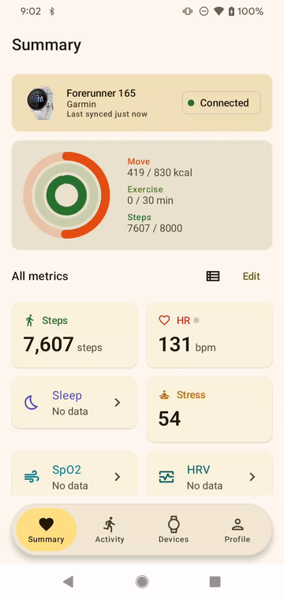
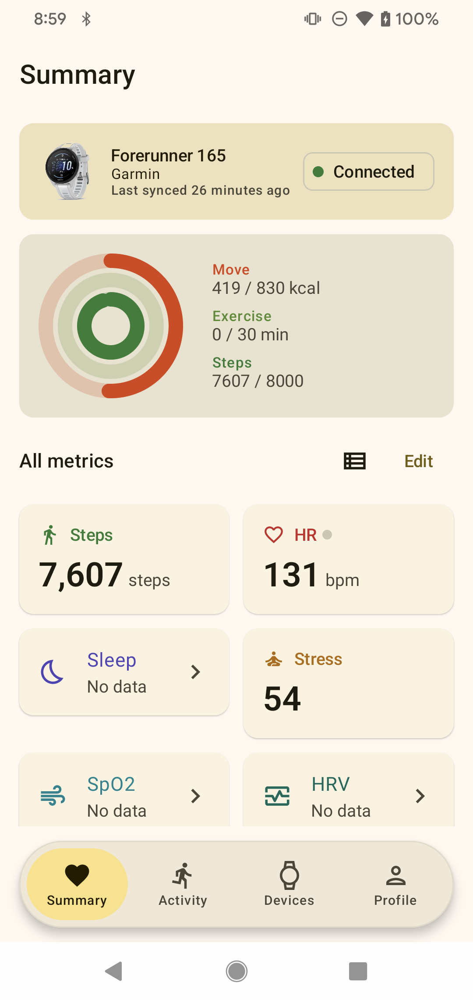
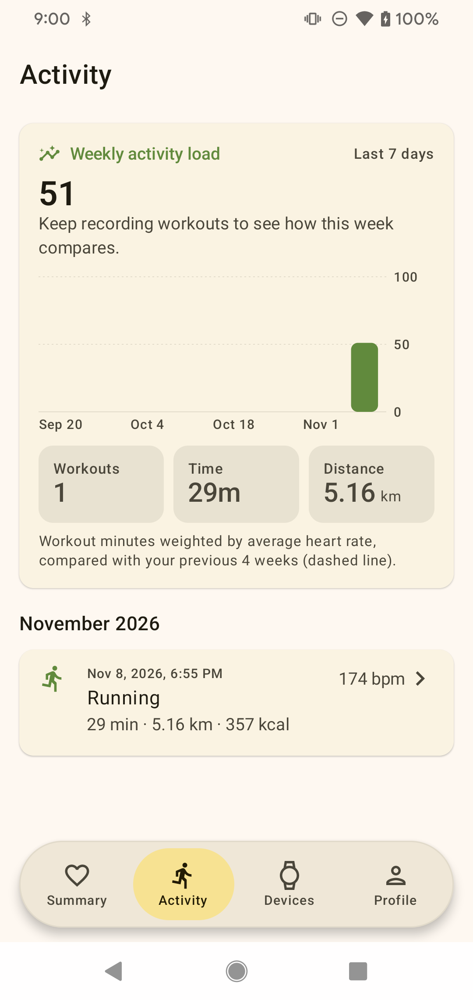
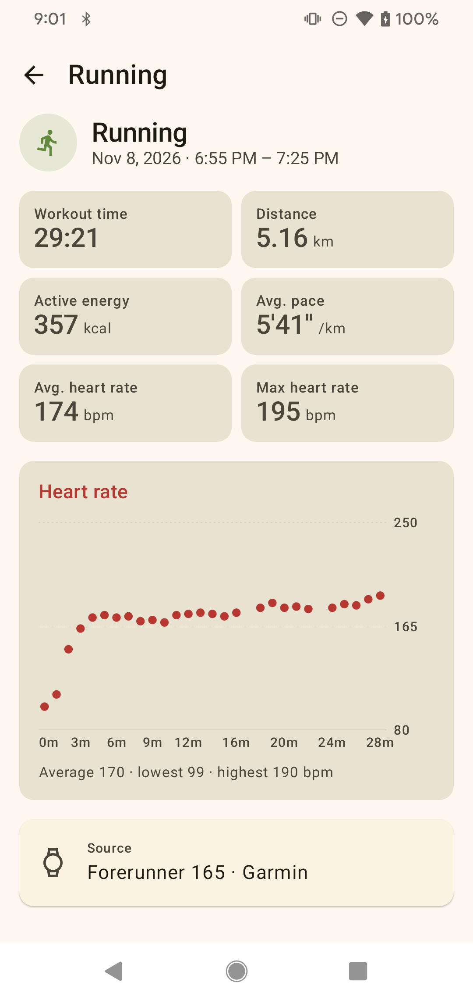
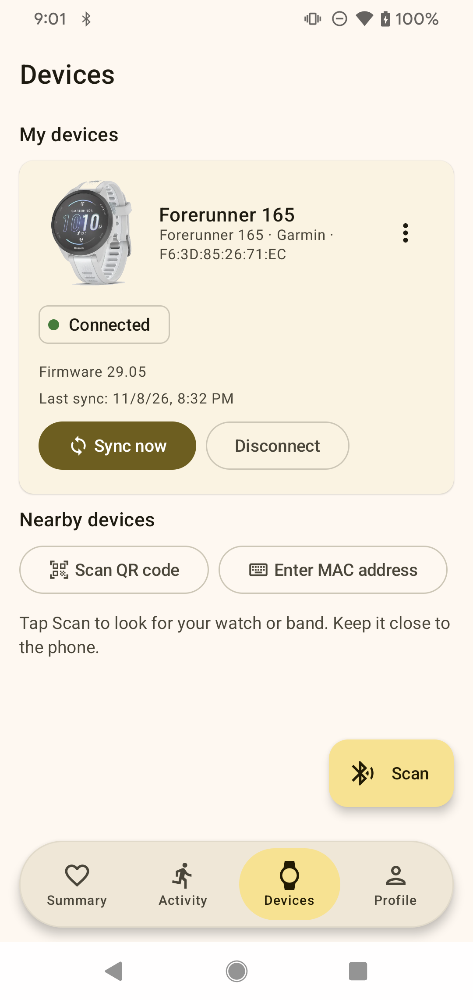
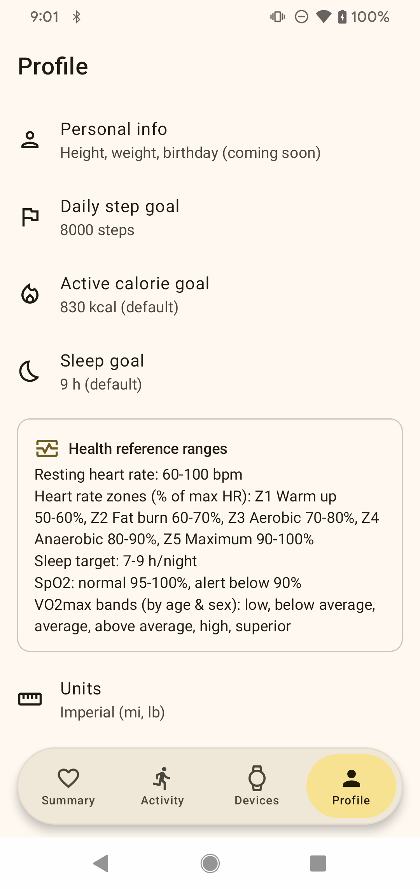
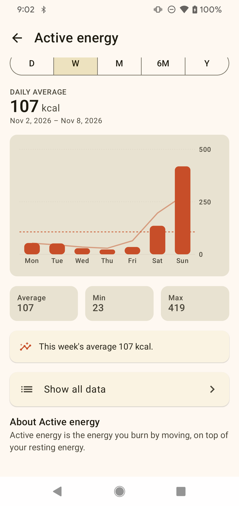

# Real-device demo — Garmin Forerunner 165

Captured 2026-11-08 directly off a connected Android phone running the debug build
(`com.unified.health.debug`), paired with a real **Garmin Forerunner 165**, via
`adb shell screencap` / `adb shell screenrecord` — no mock/demo watch, no emulator.

## Live interaction



Scrolling the Summary screen, the device banner collapses into a small chip in the header, and the
"All metrics" section switches between Grid and List display modes.

## Screens

| Screen | What it shows |
|---|---|
|  | Summary top: connected device banner ("Last synced X minutes ago"), activity rings, "All metrics" grid with real synced values (steps, heart rate, stress, VO2max…) next to metrics the watch hasn't produced yet ("No data"). |
|  | Activity tab: weekly activity-load chart plus a real recorded run (29 min, 5.16 km, 357 kcal). |
|  | Workout detail for that run: distance, pace, avg/max heart rate, and a heart-rate-over-time chart built from the watch's own FIT `record` samples. |
|  | Devices tab: the paired Forerunner 165 with its real MAC address, firmware version, last-sync time, Sync now / Disconnect. |
|  | Profile tab: step/calorie/sleep goals plus the health reference ranges (resting HR, HR zones, SpO2, VO2max bands) used across the app. |
|  | A metric detail chart (active energy) with the trend-line overlay enabled for non-Day ranges. |

## How this was captured

```bash
adb shell screencap -p /sdcard/shot.png && adb pull /sdcard/shot.png
adb shell screenrecord --time-limit 18 --bit-rate 6000000 /sdcard/home_demo.mp4 && adb pull /sdcard/home_demo.mp4
ffmpeg -i home_demo.mp4 -vf "fps=12,scale=360:-1:flags=lanczos,split[s0][s1];[s0]palettegen[p];[s1][p]paletteuse" home-demo.gif
```

This is a manual, real-hardware snapshot — not the automated mock-watch E2E suite. For the
instrumented, screenshot-per-step test suite (9 journeys, 19 flows, 98/98 steps passing) against
virtual watches, see [`docs/e2e-report/`](../e2e-report/README.md).
